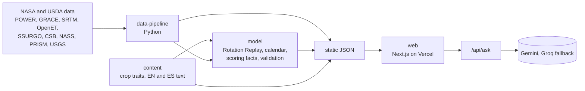
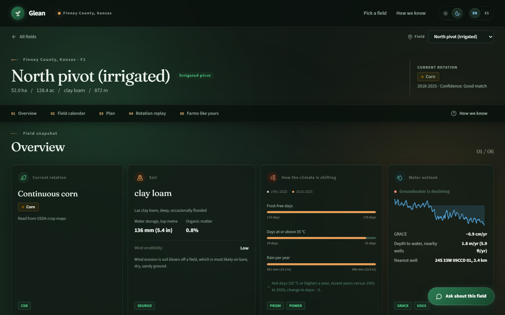

<div align="center">


# Glean

### Find the crop rotation that fits your field, backed by 25 years of NASA data

Glean runs your rotation and six alternatives through every season since 2000 on your field's own weather, soil and water. Each option shows why it fits, the evidence behind it and what to confirm locally.

<br />

[](https://glean-farms.vercel.app)
[](https://www.spaceappschallenge.org/)


<br />


<sub>The start page. Three demo fields in Finney County, Kansas, with the datasets behind them.</sub>

</div>

<br />

## Overview

Southwest Kansas farms pump from the Ogallala aquifer, and across much of the region the water table is falling. July heat hurts corn at pollination. The sandy soils that blew away in the Dust Bowl still blow when they lie bare in spring. Farmers already weigh irrigated corn against dryland wheat, sorghum and fallow, but they rarely see evidence for their own field.

Glean replays every candidate rotation on one field's daily weather from 2000 to 2025. A soil-water model built on FAO-56 tracks the water each crop gets, the water the pivot pumps, the days the soil lies bare and the value of each harvest. The farmer sets priorities and a pumping limit. Glean then puts the current rotation next to the three that fit best.

To glean is to gather what is left in a field after harvest. Glean gathers what satellites, soil surveys and crop maps have already recorded about a field.

The demo covers three real fields near Garden City:

| Field | Type | Current rotation (from USDA crop maps) |
|---|---|---|
| `f1` North pivot | Irrigated, clay loam | Continuous corn |
| `f2` Dryland wheat field | Dryland, silt loam | Wheat, sorghum, fallow |
| `f3` Sandy field | Irrigated, fine sand, wind-erodible | Corn, wheat, sorghum |

## Architecture



<br />

| Stage | Component | Role |
|---|---|---|
| **Data** | `data-pipeline/` | Fetches and cleans each dataset for the three fields: daily weather, soil profile, crop history, water use, aquifer trend, terrain and the pool of neighbouring fields |
| **Model** | Rotation Replay | Runs each rotation on 26 seasons of daily weather with FAO-56 Penman-Monteith reference ET, crop coefficients, a daily soil-water bucket, SCS curve-number runoff and a seasonal irrigation cap. Yield follows the FAO-33 water response, with heat and frost penalties |
| **Model** | Scenarios | 4 pumping caps (0, 150, 300 and 450 mm a season) times 2 climates (the actual record and a hotter, drier version), so the sliders never wait on a server |
| **Model** | Validation | Model ET against OpenET satellite ET for every field, and POWER rain against PRISM station-based rain |
| **Content** | `content/` | Crop traits with citations, and every sentence the farmer reads, in English and Spanish. The text uses placeholders, so nobody types a number by hand |
| **Web** | `web/` | Reads the precomputed JSON, scores rotations in the browser and draws the calendar, charts and map |
| **Assistant** | `/api/ask` | Sends the model only the computed facts for the chosen field and scenario. A number check marks each number in the reply as verified or not |

The app fetches no data at run time. The assistant makes the only live call, and if the model is busy it falls back to cached answers that an LLM judge has already graded.

## Features

<div align="center">

<sub>Field overview for the irrigated north pivot. Each panel names the dataset behind it.</sub>
</div>

<br />

- **Rotation Replay.** Irrigation needed, stress days, yield, revenue and bare-soil days for every year from 2000 to 2025, with the average and the worst year. The 2011 to 2012 and 2022 droughts stand out in the chart.
- **Strategy cards.** The current rotation plus the top 3 for the farmer's priorities and limits. Each card has five parts: why, evidence, benefits, information gaps and risks to check locally. Glean never names a winner.
- **Priorities and limits.** Five sliders (save water, income, steady income, soil health and erosion) and a seasonal pumping cap. Rotations that need hay or cotton equipment or a forage buyer stay hidden until the farmer has them, and a hint says what would unlock each one.
- **Field Calendar.** Months by rotation year, coloured by crop or bare soil, with 25-year odds of heat, frost, dry spells and strong wind.
- **Farms Like Yours.** Neighbouring Finney County fields on similar soil that already run a different rotation, with their real water use from OpenET. It always shows how many fields matched and labels the comparison as observational.
- **Field assistant.** Plain-language answers in English or Spanish. Every number in a reply is checked against the field's facts and tagged with its source.
- **Trust badges.** Key numbers carry an agreement badge, for example model ET against OpenET, so the farmer can see how far to trust them.
- **How we know.** Sources, methods, validation results and a glossary on one page.

## Using Glean

Open **[glean-farms.vercel.app](https://glean-farms.vercel.app)**, pick one of the three fields and work through the tabs: Overview, Field calendar, Plan, Rotation replay and Farms like yours. The **Ask about this field** button opens the assistant. The **ES** switch in the header changes the whole app to Spanish.

To run it locally:

```bash
cd web
npm install
npm run dev
```

The app reads JSON from `web/public/data`. To rebuild that JSON from the pipeline and model outputs, run `python scripts/sync_data.py`, then `python scripts/check_contract.py` to check every file against the contract.

The assistant needs an OpenAI-compatible endpoint in `web/.env.local`:

| Variable | Example |
|---|---|
| `LLM_PROVIDER` | `gemini` |
| `LLM_BASE_URL` | `https://generativelanguage.googleapis.com/v1beta/openai` |
| `LLM_MODEL` | `gemini-3.5-flash-lite` |
| `LLM_API_KEY` | your key |
| `LLM_FALLBACK_*` | the same four for a second provider, such as Groq |

Without a key the assistant still answers the suggested questions from the cache, and visitors can paste their own key in the assistant panel.

## Repository structure

```
Team-Brackets/
├── data-pipeline/           Dataset fetchers, per-field processing, neighbour matching (Python)
│   ├── fetch/               POWER, AppEEARS, SSURGO, CSB, NASS, OpenET, GRACE, USGS, PRISM
│   ├── process/             Field tables and the JSON the app reads
│   └── neighbors/           Farms Like Yours grouping
├── model/                   Rotation Replay and assistant data (Python)
│   ├── replay/              Daily water budget, yield and revenue
│   ├── calendar/            Field Calendar odds
│   ├── scoring/             Criteria and card facts
│   ├── validate/            Model against OpenET and PRISM
│   ├── assistant/           Prompt, context, number check, cache and LLM judge
│   └── tests/               Sanity and contract tests
├── content/                 Crop traits and all farmer-facing text in English and Spanish
├── design/                  Colour tokens and wireframes
├── web/                     Next.js app, charts, map and the /api/ask route
├── scripts/                 sync_data.py and check_contract.py
├── docs/                    Methods, data sources, AI use, the team contract and the pitch
└── handover/                Build briefs for each role
```

Read [docs/METHODS.md](docs/METHODS.md) for every equation and constant, and [docs/CONTRACT.md](docs/CONTRACT.md) with [CONTRACT_CHANGES.md](CONTRACT_CHANGES.md) for the file formats the roles agreed on.

## Validation

Model ET against OpenET ensemble ET, April to October, 2018 to 2025:

| Field | Bias | r² | Badge |
|---|---|---|---|
| `f1` irrigated | −1.9% | 0.79 | good |
| `f2` dryland | −29.6% | 0.34 | fair |
| `f3` sandy | +4.7% | 0.57 | fair |

On the dryland field the model under-predicts water use in fallow years. The likely cause is weeds, volunteer wheat and residue, which use more water than the model's bare soil layer. POWER rain runs 12 to 15% wetter than PRISM on all three fields, so dryland yields may read a little high. The app shows both caveats, and [docs/METHODS.md](docs/METHODS.md#validation) has the details.

## Data and credits

- **NASA POWER.** Daily weather and solar radiation, NASA Langley Research Center.
- **GRACE and GRACE-FO.** JPL mascon RL06.3, regional water storage trend, via PO.DAAC.
- **SRTM.** 30 m elevation for slope and cold-air low spots, NASA LP DAAC via AppEEARS.
- **OpenET.** Ensemble monthly ET at 30 m, used to check the model and to show neighbours' real water use.
- **SSURGO.** Soil water holding, organic matter and wind erodibility, USDA NRCS Soil Data Access.
- **Crop Sequence Boundaries.** Field outlines and crop history 2018 to 2025, USDA NASS.
- **NASS Quick Stats.** County yields and Kansas prices, USDA NASS.
- **PRISM.** 4 km daily climate, PRISM Climate Group, Oregon State University.
- **USGS groundwater.** Well levels near each field, USGS Water Data APIs.
- **Planned.** MODIS NDVI, SMAP soil moisture, ECOSTRESS and GPM IMERG. The fetchers exist, and the app marks these as missing until the data arrives.
- **Map tiles.** © OpenStreetMap contributors, ODbL.

Full table with resolutions, periods and access notes: [docs/DATA_SOURCES.md](docs/DATA_SOURCES.md). How the team used AI tools: [docs/AI_USE.md](docs/AI_USE.md).

## Team

Team Brackets, NASA Space Apps Challenge 2026.

Members: Himal Garg (Leader), Rishi Garg, Aditya, Khushal Goel, Mrudduni J. Modha, Parisha Gupta

## Disclaimer

Glean supports a farmer's judgement. It does not replace that judgement or local expert advice. Results are estimates from satellites, models and past weather. Income is gross revenue, before costs. Check with your K-State Research and Extension agent before you change a rotation.

## References

1. Allen, R. G., Pereira, L. S., Raes, D. and Smith, M. *Crop evapotranspiration: guidelines for computing crop water requirements.* FAO Irrigation and Drainage Paper 56, 1998.
2. Doorenbos, J. and Kassam, A. H. *Yield response to water.* FAO Irrigation and Drainage Paper 33, 1979.
3. USDA NRCS. *National Engineering Handbook, Part 630 Hydrology, Chapter 10: Estimation of direct runoff from storm rainfall* (curve number method), 2004.
4. Melton, F. S. et al. OpenET: filling a critical data gap in water management for the western United States. *Journal of the American Water Resources Association*, 2022.
5. Watkins, M. M. et al. Improved methods for observing Earth's time variable mass distribution with GRACE using spherical cap mascons. *Journal of Geophysical Research: Solid Earth*, 2015.
6. K-State Research and Extension. Crop production handbooks and planting guides for western Kansas.

<div align="center">
<br />
<sub>Glean · crop rotation replay for western Kansas fields, built on NASA Earth data · Apache 2.0</sub>
</div>
