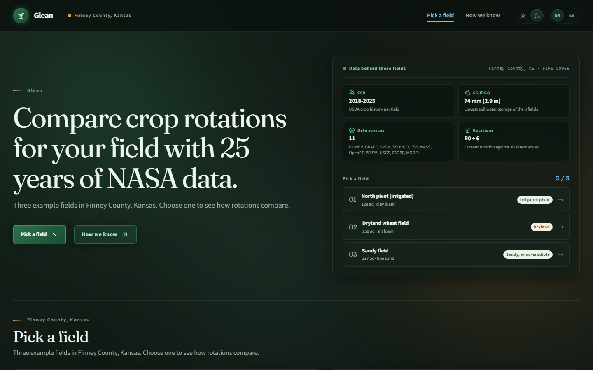
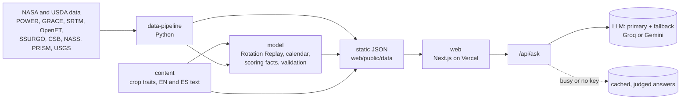

<div align="center">


# Glean

### Find the crop rotation that fits your field, backed by 25 years of NASA data

Glean replays a farmer's current rotation and a library of six candidate rotations through every season since 2000, on that field's own weather, soil and water. Each option shows why it fits, the evidence behind it and what to confirm locally.

<br />

[](https://glean-farms.vercel.app)
[](https://www.spaceappschallenge.org/)


**[How it works](#how-it-works)** · **[Features](#features)** · **[Run locally](#run-locally)** · **[Validation](#validation)** · **[Methods](docs/METHODS.md)** · **[Data sources](docs/DATA_SOURCES.md)**

<br />



<sub>The start page. Three demo fields in Finney County, Kansas, with the datasets behind them.</sub>

</div>

<br />

## The problem

Southwest Kansas farms pump from the Ogallala aquifer, and across much of the region the water table is falling. July heat hurts corn at pollination. The sandy soils that blew away in the Dust Bowl still blow when they lie bare in spring. Farmers already weigh irrigated corn against dryland wheat, sorghum and fallow, but they rarely see evidence for their own field.

Glean answers the challenge *Adapting Farms with NASA Data*: compare at least three rotation strategies, including the one the farmer runs today, and for each say why it was suggested, what supports it, what it gains, where information is missing and what to check locally.

> [!NOTE]
> To glean is to gather what is left in a field after harvest. Glean gathers what satellites, soil surveys and crop maps have already recorded about a field.

### At a glance

| | |
|---|---|
| **Region** | Finney County, Kansas (FIPS `20055`), near Garden City |
| **Fields** | 3 real demo fields, plus neighbouring fields for comparison |
| **Seasons replayed** | 26, from 2000 to 2025, including the 2002, 2011, 2012 and 2022 droughts |
| **Scenarios** | 4 pumping caps (dryland, 150, 300, 450 mm a season) × 2 climates (actual record, hotter and drier) |
| **Languages** | English and Spanish, across the whole app |
| **Live calls** | One: the field assistant. Everything else is precomputed JSON |

## How it works

1. **Gather.** `data-pipeline/` pulls each dataset for the three fields: daily weather, soil profile, crop history, satellite water use, aquifer trend, terrain and a pool of neighbouring fields.
2. **Replay.** `model/` runs every rotation on 26 seasons of daily weather. A daily soil-water bucket uses FAO-56 Penman-Monteith reference ET, crop coefficients, SCS curve-number runoff and a seasonal irrigation cap. Yield follows the FAO-33 water response, with heat and frost penalties.
3. **Precompute.** Every field × scenario × rotation result is written as static JSON, so the sliders never wait on a server.
4. **Explain.** `content/` holds every sentence the farmer reads, in English and Spanish, as templates with placeholders. Nobody types a number by hand.
5. **Compare.** `web/` scores rotations in the browser against the farmer's priorities and shows the current rotation next to the three that fit best.



### The rotation library

Each field is compared against these candidates. Rotations the field can't run are filtered out. A dryland field gets no irrigated options, and a rotation that needs hay or cotton equipment or a forage buyer stays hidden until the farmer says they have it.

| ID | Rotation | Water | Needs |
|---|---|---|---|
| `R1` | Corn → wheat → sorghum | Irrigated, at least 150 mm | — |
| `R2` | Wheat → sorghum → fallow | Dryland | — |
| `R3` | Wheat → sorghum → triticale | Dryland | Hay equipment, forage buyer |
| `R4` | Alfalfa (4 years) → corn → wheat | Irrigated, at least 300 mm | Hay equipment, forage buyer |
| `R5` | Corn → soybean → wheat + rye cover | Irrigated, at least 150 mm | — |
| `R6` | Cotton → wheat → sorghum | Dryland | Cotton equipment |

### The demo fields

| Field | Type | Current rotation (from USDA crop maps, 2018 to 2025) |
|---|---|---|
| `f1` North pivot | Irrigated, clay loam, 128 ac | Continuous corn |
| `f2` Dryland wheat field | Dryland, silt loam, 158 ac | Wheat, sorghum, fallow (`R2`) |
| `f3` Sandy field | Irrigated, fine sand, 137 ac, highly wind-erodible | Corn, wheat, sorghum (`R1`) |

## Features

<div align="center">

<sub>Field overview for the irrigated north pivot. Each panel names the dataset behind it.</sub>
</div>

<br />

| Feature | What the farmer sees |
|---|---|
| **Rotation Replay** | Irrigation needed, stress days, yield, revenue and bare-soil days for every year from 2000 to 2025, with the average and the worst year. The drought years stand out in the chart. |
| **Strategy cards** | The current rotation plus the top 3 for the farmer's priorities and limits. Each card has five parts: why, evidence, benefits, information gaps and risks to check locally. Glean never names a single winner. |
| **Priorities and limits** | Five sliders (save water, income, steady income, soil health, erosion) and a seasonal pumping cap. Locked rotations show a hint that says what would unlock them. |
| **Field Calendar** | Months by rotation year, coloured by crop or bare soil, with 25-year odds of heat, frost, dry spells, storms and strong wind. |
| **Farms Like Yours** | Neighbouring Finney County fields on similar soil that already run a different rotation, with their real water use from OpenET. It always shows how many fields matched and labels the comparison as observational. |
| **Field assistant** | Plain-language answers in English or Spanish. Every number in a reply is checked against the field's facts, marked verified or unverified, and tagged with its source. |
| **Trust badges** | Key numbers carry an agreement badge, for example model ET against OpenET, so the farmer can see how far to trust them. |
| **How we know** | Sources, methods, validation results and a glossary on one page. |

## Using Glean

Open **[glean-farms.vercel.app](https://glean-farms.vercel.app)**, pick one of the three fields and work through the sections: **Overview**, **Field calendar**, **Compare your options**, **Rotation replay** and **Farms like yours**.

- **Ask about this field** opens the assistant.
- **EN / ES** in the header switches the whole app between English and Spanish.
- The header also has a light and dark theme switch.

## Run locally

### Web app

Needs Node.js 20 or later. The committed JSON in `web/public/data` is enough. You don't need to run the Python steps to use the app.

```bash
cd web
npm ci
npm run dev        # http://localhost:3000
```

The satellite basemap loads Esri World Imagery tiles, so the map needs an internet connection.

### Assistant (optional)

Copy `web/.env.example` to `web/.env.local` and fill in an OpenAI-compatible endpoint. The primary provider is tried first. The fallback is tried once if the primary is rate-limited (429), errors (5xx), returns an empty answer or times out.

| Variable | Example |
|---|---|
| `LLM_PROVIDER` | `groq` |
| `LLM_BASE_URL` | `https://api.groq.com/openai/v1` |
| `LLM_MODEL` | a model id from that provider |
| `LLM_API_KEY` | your key |
| `LLM_FALLBACK_PROVIDER`, `_BASE_URL`, `_MODEL`, `_API_KEY` | the same four for a second provider, such as Gemini at `https://generativelanguage.googleapis.com/v1beta/openai` |
| `ALLOW_CUSTOM_LLM_URL` | `1` to let visitors' own keys reach any https endpoint |

Without a key, the assistant still answers the suggested questions from the cache. Visitors can also paste their own key in the assistant panel. By default that key may only be sent to `api.groq.com` or `generativelanguage.googleapis.com`.

### Rebuilding the data (optional)

The Python steps regenerate the committed JSON. They need Python 3.12 and their own virtual environments. See [data-pipeline/README.md](data-pipeline/README.md) and [model/README.md](model/README.md) for setup and API keys.

```bash
python data-pipeline/run_all.py    # fetch and process datasets → data-pipeline/out/
python model/run_all.py            # replay, calendar, scoring, validation → model/out/web/
python scripts/sync_data.py        # copy every output into web/public/data
python scripts/check_contract.py   # check every file against the data contract
```

### Checks

```bash
cd web && npm test && npm run typecheck && npm run build
python -m pytest model             # from the repo root, inside the model venv
```

## Validation

Model ET against OpenET ensemble ET, April to October months, 2018 to 2025 (n = 56 per field):

| Field | Bias | r² | Badge |
|---|---|---|---|
| `f1` irrigated, clay loam | +0.9% | 0.80 | good |
| `f2` dryland, silt loam | −29.6% | 0.34 | fair |
| `f3` irrigated, fine sand | +6.5% | 0.60 | good |

> [!WARNING]
> **Two known caveats, both shown in the app.**
> On the dryland field the model under-predicts water use, mostly in fallow years. The likely cause is weeds, volunteer wheat and residue, which use more water than the model's bare-soil layer.
> NASA POWER rain runs about 12 to 15% wetter than PRISM station-based rain on all three fields (r ≈ 0.93), so dryland yields may read a little high.

Badge rules and the full method are in [docs/METHODS.md](docs/METHODS.md#validation).

## Repository structure

```
Team-Brackets/
├── data-pipeline/     Dataset fetchers, per-field processing, neighbour matching (Python)
│   ├── fetch/         POWER, AppEEARS, SSURGO, CSB, NASS, OpenET, GRACE, USGS, PRISM, IMERG
│   ├── process/       Field tables and the JSON the app reads
│   └── neighbors/     Farms Like Yours grouping
├── model/             Rotation Replay and assistant data (Python)
│   ├── replay/        Daily water budget, yield and revenue
│   ├── calendar/      Field Calendar odds
│   ├── scoring/       Criteria and card facts
│   ├── validate/      Model against OpenET and PRISM
│   ├── assistant/     Prompt, context, number check, cache and LLM judge
│   ├── mock/          Schema-exact mock outputs
│   └── tests/         Sanity and contract tests
├── content/           Crop traits and all farmer-facing text in English and Spanish
├── design/            Colour tokens and wireframes
├── web/               Next.js app, charts, map, tests and the /api/ask route
├── scripts/           sync_data.py and check_contract.py
├── docs/              Methods, data sources, AI use, data contract and pitch
└── handover/          Build briefs for each team role
```

### Documentation

| Doc | What's in it |
|---|---|
| [docs/METHODS.md](docs/METHODS.md) | Every equation, constant and validation rule |
| [docs/DATA_SOURCES.md](docs/DATA_SOURCES.md) | Each dataset with resolution, period and access notes |
| [docs/CONTRACT.md](docs/CONTRACT.md), [CONTRACT_CHANGES.md](CONTRACT_CHANGES.md) | The JSON file formats the roles agreed on, and how they changed |
| [docs/AI_USE.md](docs/AI_USE.md) | How the assistant is grounded and judged, and how the team used AI tools |
| [handover/](handover/) | Build briefs for data, model and AI, frontend, and design and content |

## Data and credits

| Source | Used for | Provider |
|---|---|---|
| **NASA POWER** | Daily weather and solar radiation | NASA Langley Research Center |
| **GRACE / GRACE-FO** | Regional water-storage trend (JPL mascon RL06.3) | NASA JPL via PO.DAAC |
| **SRTM** | 30 m elevation for slope and cold-air low spots | NASA LP DAAC via AppEEARS |
| **OpenET** | Ensemble monthly ET at 30 m: model check and neighbours' water use | OpenET |
| **SSURGO** | Soil water holding, organic matter, wind erodibility | USDA NRCS Soil Data Access |
| **Crop Sequence Boundaries** | Field outlines and crop history, 2018 to 2025 | USDA NASS |
| **NASS Quick Stats** | County yields and Kansas prices | USDA NASS |
| **PRISM** | 4 km daily climate, used to check POWER rain | PRISM Climate Group, Oregon State University |
| **USGS groundwater** | Well levels near each field | USGS Water Data APIs |
| **Esri World Imagery** | Satellite basemap | Esri and its data partners |

**Planned:** MODIS NDVI, SMAP soil moisture, ECOSTRESS and GPM IMERG. The fetchers exist, and the app marks these as missing until the data arrives.

## Team

**Team Brackets**, NASA Space Apps Challenge 2026.

Himal Garg (lead) · Rishi Garg · Aditya · Khushal Goel · Mrudduni J. Modha · Parisha Gupta

## Disclaimer

> [!IMPORTANT]
> Glean supports a farmer's judgement. It does not replace that judgement or local expert advice. Results are estimates from satellites, models and past weather. Income is gross revenue, before costs. Check with your K-State Research and Extension agent before you change a rotation.

## References

1. Allen, R. G., Pereira, L. S., Raes, D. and Smith, M. *Crop evapotranspiration: guidelines for computing crop water requirements.* FAO Irrigation and Drainage Paper 56, 1998.
2. Doorenbos, J. and Kassam, A. H. *Yield response to water.* FAO Irrigation and Drainage Paper 33, 1979.
3. USDA NRCS. *National Engineering Handbook, Part 630 Hydrology, Chapter 10: Estimation of direct runoff from storm rainfall* (curve number method), 2004.
4. Melton, F. S. et al. OpenET: filling a critical data gap in water management for the western United States. *Journal of the American Water Resources Association*, 2022.
5. Watkins, M. M. et al. Improved methods for observing Earth's time variable mass distribution with GRACE using spherical cap mascons. *Journal of Geophysical Research: Solid Earth*, 2015.
6. K-State Research and Extension. Crop production handbooks and planting guides for western Kansas.

## License

Apache 2.0. See [LICENSE](LICENSE).

<div align="center">
<br />
<sub>Glean · crop rotation replay for western Kansas fields, built on NASA Earth data</sub>
</div>
