<div align="center">


# Glean

**Compare crop rotations on your own field, tested against 26 years of its real weather.**

Glean replays a farm's current rotation and six alternatives on every season from 2000 to 2025, using NASA weather, USDA soil and crop maps, and satellite water use. It then lines up the options against the farmer's own priorities and explains each one.

[](https://glean-farms.vercel.app)
[](https://www.spaceappschallenge.org/2026/challenges/adapting-farms-with-nasa-data/)
[](LICENSE)

[Live demo](https://glean-farms.vercel.app) · [Tour](#tour-of-the-app) · [How it works](#how-it-works) · [Data](#data-sources-and-terms) · [Quick start](#quick-start) · [Methods](docs/METHODS.md)

<br />

<picture>
  <source media="(prefers-color-scheme: dark)" srcset="docs/assets/readme/hero-dark.webp" />
  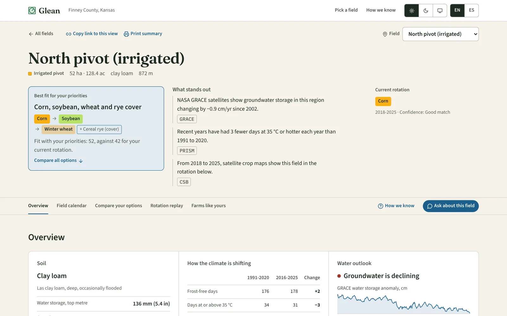
</picture>

<sub>The field page for the irrigated North pivot. Every highlight names the dataset behind it. The image follows your GitHub theme.</sub>

</div>

> [!IMPORTANT]
> Glean supports a farmer's judgement. It does not replace it. Results are estimates from a simplified model run on past weather, and income is gross revenue before costs. Check with a K-State Research and Extension agent before you change a rotation.

## At a glance

| | |
|---|---|
| **Challenge** | NASA Space Apps 2026, [Field Shift: Adapting Farms with NASA Data](https://www.spaceappschallenge.org/2026/challenges/adapting-farms-with-nasa-data/) |
| **Fields** | 3 real fields near Garden City, Finney County, Kansas, taken from USDA Crop Sequence Boundaries |
| **Options compared** | The field's current rotation (R0) and 6 alternatives (R1 to R6) |
| **Replay** | 26 seasons (2000 to 2025) of daily weather, under 8 scenarios: 4 pumping limits times 2 climates |
| **Data** | 9 datasets delivered, 3 of them NASA. 4 more NASA datasets have fetchers but no data yet ([details](#data-sources-and-terms)) |
| **Checked against** | OpenET satellite water use (good match on 2 of 3 fields) and PRISM station-based rain |
| **Languages** | English and Spanish, every screen and every assistant answer |
| **Stack** | Python 3.12 (pandas, pyet) for data and model; Next.js 15, React 19, TypeScript, Recharts and Leaflet for the app |

<details>
<summary><b>Contents</b></summary>

- [Why Glean](#why-glean)
- [Tour of the app](#tour-of-the-app)
- [Results on the demo fields](#results-on-the-demo-fields)
- [How it works](#how-it-works)
- [Validation](#validation)
- [Data sources and terms](#data-sources-and-terms)
- [Known limitations](#known-limitations)
- [Quick start](#quick-start)
- [Repository layout](#repository-layout)
- [Documentation](#documentation)
- [Use of AI](#use-of-ai)
- [Team](#team)
- [License and credits](#license-and-credits)
- [References](#references)

</details>

## Why Glean

Farms in southwest Kansas pump from the Ogallala aquifer, and across much of the region the water table is falling. July heat hurts corn at pollination. The sandy soils that blew away in the Dust Bowl still blow when they lie bare in spring. Farmers already weigh irrigated corn against dryland wheat, sorghum and fallow, but they rarely see evidence for their own field.

Glean gives them that evidence. It asks one question for every option: *how would this rotation have done on this field, in each of the last 26 years?* To glean is to gather what is left in a field after harvest. Glean gathers what satellites, soil surveys and crop maps have already recorded about a field.

The demo covers three fields that show the main trade-offs in the region:

| Field | Size | Type and soil | Current rotation (USDA crop maps, 2018 to 2025) | What it tests |
|---|---|---|---|---|
| `f1` North pivot | 52 ha (128 ac) | Irrigated pivot, Las clay loam | Continuous corn | Water use against income |
| `f2` Dryland wheat field | 64 ha (158 ac) | No well, Richfield silt loam | Wheat, sorghum, fallow | Options without irrigation |
| `f3` Sandy field | 55 ha (137 ac) | Irrigated pivot, Valent fine sand, wind erodibility group 1 | Corn, wheat, sorghum | Wind erosion on bare sand |

### The rotation library

Each field is compared against these six candidates as well as its current rotation (R0). Options the field cannot run are filtered out: a dryland field gets no irrigated options, and a rotation that needs hay or cotton equipment or a forage buyer stays hidden until the farmer says they have it.

| ID | Rotation | Water | Needs |
|---|---|---|---|
| `R1` | Corn, wheat, sorghum | Irrigated, at least 150 mm a season | Nothing extra |
| `R2` | Wheat, sorghum, fallow | Dryland | Nothing extra |
| `R3` | Wheat, sorghum, forage triticale (flex fallow) | Dryland | Hay equipment and a forage buyer |
| `R4` | Alfalfa for 4 years, then corn and wheat | Irrigated, at least 300 mm a season | Hay equipment and a forage buyer |
| `R5` | Corn, soybean, wheat and a rye cover | Irrigated, at least 150 mm a season | Nothing extra |
| `R6` | Cotton, wheat, sorghum | Dryland | Cotton equipment |

## Tour of the app

Open the [live demo](https://glean-farms.vercel.app), pick a field and scroll through the sections, or jump in with the links below each screen. Screens follow your GitHub theme.

### Compare your options

<picture>
  <source media="(prefers-color-scheme: dark)" srcset="docs/assets/readme/cards-dark.webp" />
  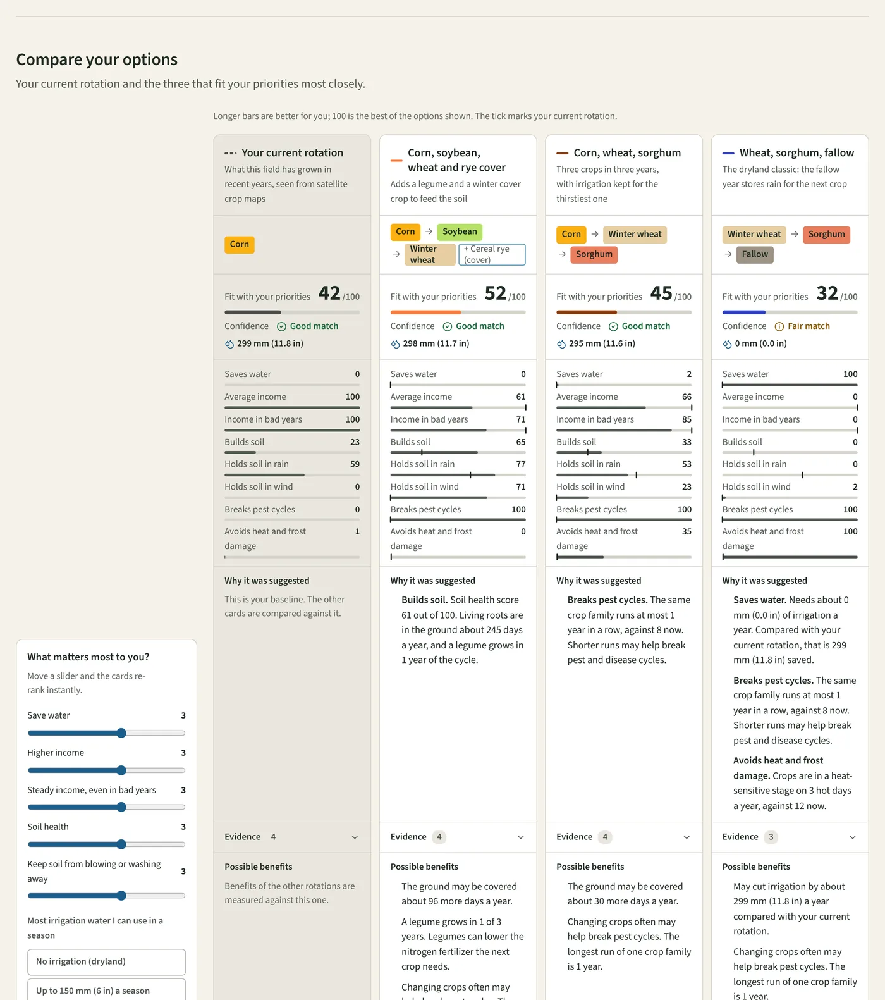
</picture>

The current rotation always comes first, followed by the three options that best fit the farmer's priorities. Five sliders set what matters: saving water, income, steady income in bad years, soil health and erosion. A pumping limit and three checkboxes (hay equipment, cotton equipment, a forage buyer) remove options the farm cannot run, and each removed option says what would bring it back.

Each card has five parts: **why it was suggested**, **evidence**, **possible benefits**, **what we don't know** and **risks to check locally**. Glean never names a winner.

[Open this view for f1](https://glean-farms.vercel.app/field/f1#strategies)

### Rotation replay

<picture>
  <source media="(prefers-color-scheme: dark)" srcset="docs/assets/readme/replay-dark.webp" />
  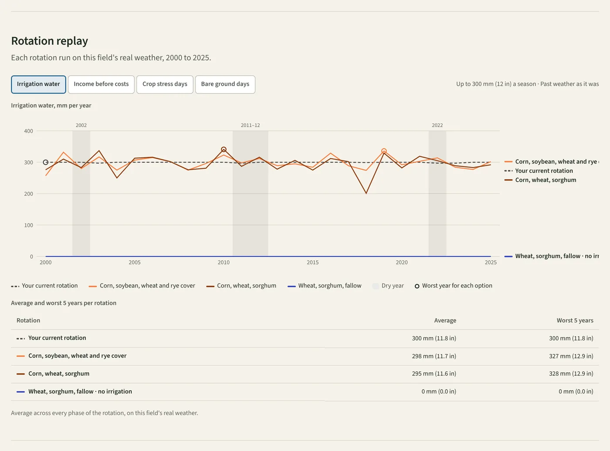
</picture>

Every option, replayed on the field's daily weather from 2000 to 2025. Switch between irrigation water, income before costs, crop stress days and bare ground days. Drought years are shaded and each option's worst year is circled, so the farmer sees the bad seasons as well as the average.

[Open this view for f1](https://glean-farms.vercel.app/field/f1#replay)

### Field calendar

<picture>
  <source media="(prefers-color-scheme: dark)" srcset="docs/assets/readme/calendar-dark.webp" />
  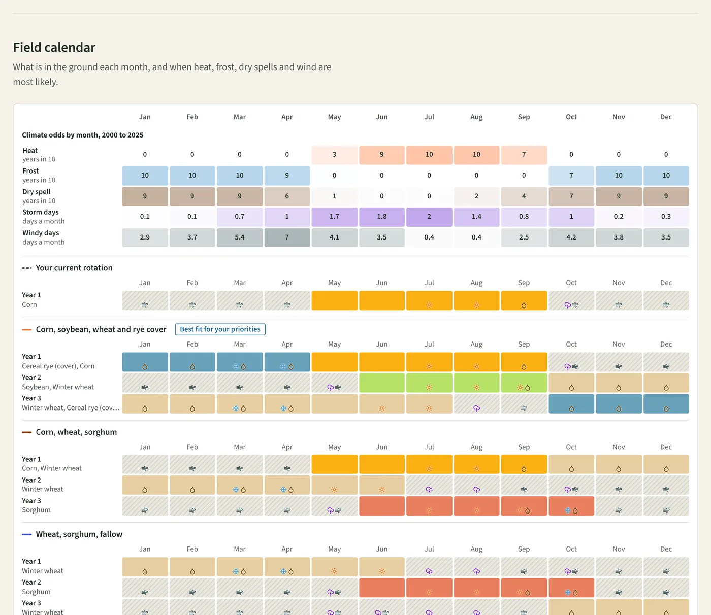
</picture>

Months by rotation year, coloured by crop, with bare soil hatched. Above it sit the odds of heat, frost, dry spells, storms and strong wind for each month, counted over 2000 to 2025, so the farmer can see when bare ground meets windy months.

[Open this view for f1](https://glean-farms.vercel.app/field/f1#calendar)

### Farms like yours and the field assistant

<table>
<tr>
<td width="38%" valign="top">

<picture>
  <source media="(prefers-color-scheme: dark)" srcset="docs/assets/readme/neighbors-dark.webp" />
  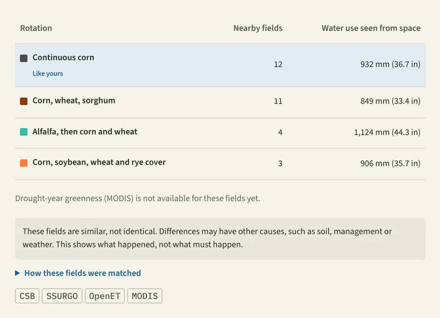
</picture>

**Farms like yours.** Nearby fields on similar soil with the same irrigation status that already run another rotation, with their real water use from OpenET. The count of fields is always shown, and the comparison is labelled observational.

</td>
<td width="62%" valign="top">

<picture>
  <source media="(prefers-color-scheme: dark)" srcset="docs/assets/readme/assistant-dark.webp" />
  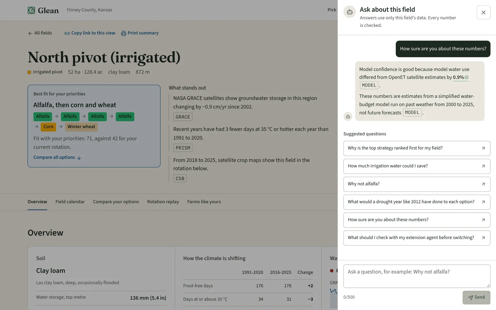
</picture>

**Field assistant.** Plain-language answers in English or Spanish, built only from the field's computed facts. Every number in a reply is checked against those facts: a tick means it matched, and each sentence carries a source tag.

</td>
</tr>
</table>

### How we know, Spanish and phones

<table>
<tr>
<td width="40%" valign="top">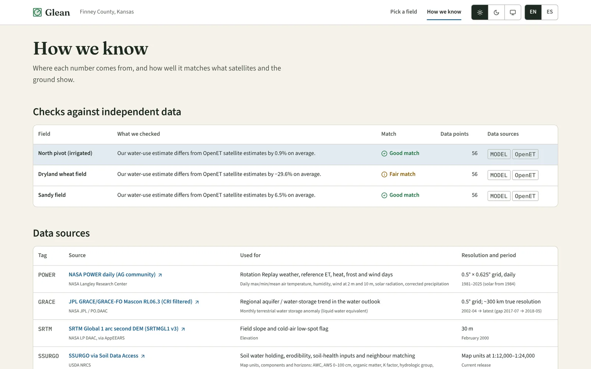<br /><sub><b>How we know.</b> Validation results, every source with its resolution and period, and a glossary.</sub></td>
<td width="40%" valign="top">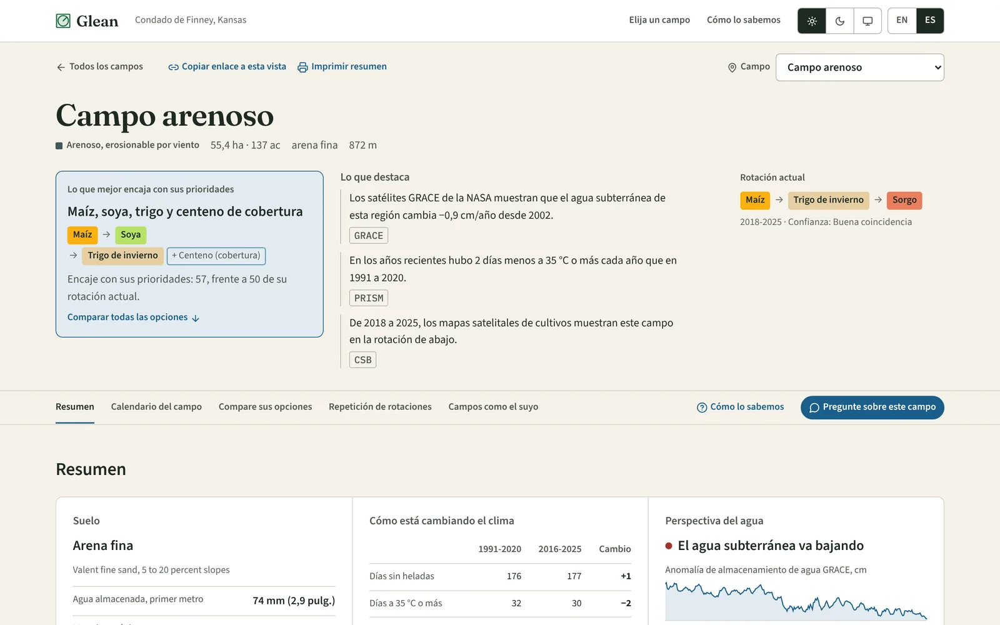<br /><sub><b>Español.</b> The ES switch translates the whole app, including card text and saved answers.</sub></td>
<td width="20%" valign="top">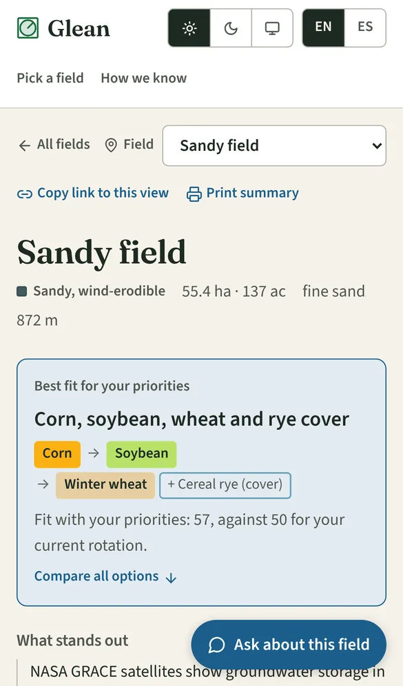<br /><sub><b>Phone.</b> Built for a phone in the cab.</sub></td>
</tr>
</table>

## Results on the demo fields

Default settings: every slider at 3, a pumping limit of 300 mm (11.8 in) a season, past weather as it was, and no hay equipment, cotton equipment or forage buyer. The fit score runs from 0 to 100 against the other options on the same field. The figures come from `web/public/data`, the same files the app reads.

| Field | Current rotation | Best fit at default settings | Fit (current → best) | What changes |
|---|---|---|---|---|
| `f1` North pivot | Continuous corn | Corn, soybean, wheat and rye cover | 42 → 52 | About the same water (298 mm against 299 mm a year). Average gross income falls from $669 to $447 an acre, and wind exposure falls by more than half |
| `f2` Dryland | Wheat, sorghum, fallow | No alternative fits without changes | 22 | With hay equipment and a forage buyer, wheat, sorghum and forage triticale (flex fallow) scores 70 |
| `f3` Sandy | Corn, wheat, sorghum | Corn, soybean, wheat and rye cover | 50 → 57 | Same water, and the wind erosion index on this sand drops from 14.8 to 7.8 |

> [!NOTE]
> The table shows trade-offs, not advice. On `f1`, continuous corn still has the highest average income. The cards show that next to the other criteria, and the farmer decides how much each one matters.

## How it works

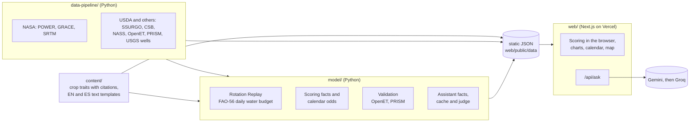

The app fetches no data at run time. Everything is precomputed into static JSON, and `scripts/check_contract.py` checks every file against the shared [data contract](docs/CONTRACT.md). The assistant makes the only live call.

### The model

For each field, each rotation and each of the 8 scenarios, the Rotation Replay runs a daily soil-water budget from 1999 (a short warm-up) to 2025. Full equations and every constant are in [docs/METHODS.md](docs/METHODS.md).

| Step | Method | Source |
|---|---|---|
| Reference evapotranspiration | FAO-56 Penman-Monteith, from POWER daily weather | [[1]](#references) |
| Crop water use | FAO-56 crop coefficients and root growth by growth stage | [[1]](#references) |
| Soil water | Two-layer bucket (root zone and the soil below), so water stored in fallow is there for the next crop | [[1]](#references) |
| Runoff | SCS curve number by soil hydrologic group | [[3]](#references) |
| Irrigation | The pivot refills the root zone when it gets too dry, up to the season's pumping limit | Model rule |
| Yield and income | Water response factor (Ky), with heat and frost penalties, times the county yield and 2020 to 2024 price | [[2]](#references), NASS |
| Erosion exposure | Bare days with heavy rain or strong wind, scaled by soil erodibility and crop residue | SSURGO, model rule |

Results are averaged over every starting year of each rotation, so the order of the crops does not depend on where the cycle begins. The scenarios are 4 pumping limits (none, 150, 300 and 450 mm a season) times 2 climates: the actual record, and a hotter, drier version (1.5 °C warmer, 15% less rain).

### Scoring

Each option gets 8 criteria: water use, average income, income in the 5 worst years, soil health, water erosion, wind erosion, pest break and heat or frost risk. Each criterion is scaled from 0 (worst option on this field) to 100 (best):

```math
\text{norm}_k(r) = 100 \times \frac{\text{raw}_k(r) - \text{worst}_k}{\text{best}_k - \text{worst}_k}
```

The five sliders, each set from 0 to 5, spread their weight over the criteria. For example, "steady income" puts 70% on worst-year income and 30% on heat and frost risk. The fit score is the weighted mean:

```math
w_k = \sum_{s \,\in\, \text{sliders}} v_s \, \text{share}_{s,k}
\qquad
\text{score}(r) = \frac{\sum_k w_k \, \text{norm}_k(r)}{\sum_k w_k}
```

The browser recomputes this on every slider move ([`web/lib/score.ts`](web/lib/score.ts)), so the cards re-rank at once. The model computes the same values in Python ([`model/scoring/criteria.py`](model/scoring/criteria.py)) for its checks.

### The field assistant

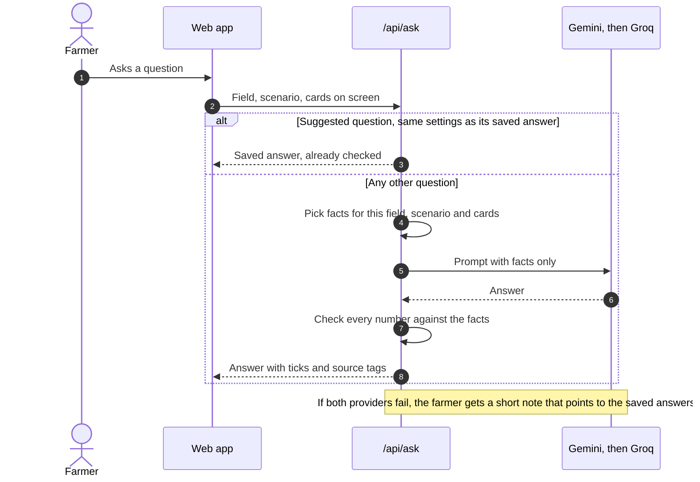

The model never sees farmer data. It gets about 340 facts per field, each one sentence with a number, unit and source tag, and only those for the current scenario reach the prompt. A number check, written once in Python and once in TypeScript and kept identical by a shared test file, marks each number as verified or not. Visitors can also use their own Groq or Gemini key. See [docs/AI_USE.md](docs/AI_USE.md).

## Validation

Model water use (actual evapotranspiration) against OpenET satellite estimates, for April to October from 2018 to 2025, on each field's real crop history (56 months per field):

| Field | Model total | OpenET total | Bias | r² | Badge in the app |
|---|---|---|---|---|---|
| `f1` irrigated | 6,018 mm | 5,963 mm | +0.9% | 0.80 | Good match |
| `f2` dryland | 3,016 mm | 4,284 mm | −29.6% | 0.34 | Fair match |
| `f3` sandy | 6,020 mm | 5,655 mm | +6.5% | 0.60 | Good match |

A good match needs a bias within 15% and r² of at least 0.6. A fair match needs a bias within 30%.

- **The dryland field is under-predicted.** In fallow years, weeds, volunteer wheat and residue use more water than the model's thin bare-soil layer allows. Treat `f2` numbers with more care.
- **POWER rain runs wetter than PRISM.** Against PRISM station-based rain (2000 to 2025, 312 months), POWER is 15%, 12% and 12% wetter on `f1`, `f2` and `f3` (r 0.92 to 0.93). Dryland yields and stored fallow water may read a little high.

> [!WARNING]
> Two planned checks are missing because their data has not arrived: modelled soil moisture against SMAP, and POWER rain against GPM IMERG. The app leaves them out instead of showing placeholder numbers.

## Data sources and terms

<table>
<tr><th>Tag</th><th>Dataset</th><th>NASA</th><th>Used for</th><th>Resolution, period</th><th>Terms</th></tr>
<tr><td><code>POWER</code></td><td><a href="https://power.larc.nasa.gov/">NASA POWER daily (AG)</a></td><td>Yes</td><td>Replay weather, reference ET, heat, frost and wind days</td><td>0.5° × 0.625°, 1981 to 2025</td><td rowspan="3"><a href="https://www.earthdata.nasa.gov/engage/open-data-services-software-policies/data-use-guidance">NASA open data</a>, no restrictions</td></tr>
<tr><td><code>GRACE</code></td><td><a href="https://podaac.jpl.nasa.gov/dataset/TELLUS_GRAC-GRFO_MASCON_CRI_GRID_RL06.3_V4">GRACE and GRACE-FO JPL mascon RL06.3</a></td><td>Yes</td><td>Regional groundwater storage trend</td><td>0.5° grid (about 300 km true), 2002 to now</td></tr>
<tr><td><code>SRTM</code></td><td><a href="https://lpdaac.usgs.gov/products/srtmgl1v003/">SRTM 1 arc-second DEM</a></td><td>Yes</td><td>Slope and cold-air low spots</td><td>30 m, 2000</td></tr>
<tr><td><code>OpenET</code></td><td><a href="https://etdata.org/">OpenET ensemble</a></td><td>Partner</td><td>Model check and neighbours' real water use</td><td>30 m monthly, 2016 to now</td><td>Free with attribution, see provider terms</td></tr>
<tr><td><code>SSURGO</code></td><td><a href="https://sdmdataaccess.sc.egov.usda.gov/">SSURGO via Soil Data Access</a></td><td>No</td><td>Soil water holding, erodibility, neighbour matching</td><td>1:12,000 to 1:24,000</td><td rowspan="4">U.S. Government work, public domain</td></tr>
<tr><td><code>CSB</code></td><td><a href="https://www.nass.usda.gov/Research_and_Science/Crop-Sequence-Boundaries/">USDA Crop Sequence Boundaries</a></td><td>No</td><td>Field outlines, crop history, current rotation, neighbour pool</td><td>Field polygons, 2018 to 2025</td></tr>
<tr><td><code>NASS</code></td><td><a href="https://quickstats.nass.usda.gov/">USDA NASS Quick Stats</a></td><td>No</td><td>County yields, Kansas prices, local market check</td><td>County to state, 2000 to 2025</td></tr>
<tr><td><code>USGS</code></td><td><a href="https://api.waterdata.usgs.gov/">USGS Water Data APIs</a></td><td>No</td><td>Well levels near each field</td><td>Individual wells, 2000 to 2025</td></tr>
<tr><td><code>PRISM</code></td><td><a href="https://prism.oregonstate.edu/">PRISM daily</a></td><td>No</td><td>Climate normals and a ground-based check of POWER</td><td>4 km, 1991 to 2025</td><td>Free with attribution, see provider terms</td></tr>
</table>

**Methods cited as sources:** `FAO56` ([FAO Irrigation and Drainage Paper 56](https://www.fao.org/4/x0490e/x0490e00.htm)) and `MODEL` (the Glean water budget, [docs/METHODS.md](docs/METHODS.md)). **Map imagery:** Esri World Imagery, attributed on every map.

<details>
<summary><b>Planned NASA datasets that have not arrived yet</b> (4)</summary>

The fetchers exist in `data-pipeline/fetch/`, and the model and app pick the data up as soon as it lands. Until then the app marks these sources as missing.

| Tag | Dataset | Planned use | Why it is missing |
|---|---|---|---|
| `IMERG` | [GPM IMERG Final daily](https://disc.gsfc.nasa.gov/datasets/GPM_3IMERGDF_07/summary) | Storm days and a rain check | Needs an Earthdata login |
| `SMAP` | [SMAP L4 root-zone soil moisture](https://nsidc.org/data/spl4smgp) | Soil-water check | AppEEARS task needs an Earthdata login |
| `MODIS` | [MOD13Q1 NDVI](https://lpdaac.usgs.gov/products/mod13q1v061/) | Greenness of neighbours in drought years | AppEEARS needs an Earthdata login; the ORNL fallback is still downloading |
| `ECOSTRESS` | [ECOSTRESS ET and ESI](https://lpdaac.usgs.gov/products/eco_l3t_jetv002/) | Plant water stress snapshots | AppEEARS task needs an Earthdata login |

</details>

<details>
<summary><b>Datasets we chose not to use</b> (8)</summary>

GEDI, LANDFIRE, NLCD, ERA5, GLDAS, NLDAS, STATSGO2 and Ag Data Commons. [docs/DATA_SOURCES.md](docs/DATA_SOURCES.md) gives the reason for each, along with access notes.

</details>

## Known limitations

- **One soil per field.** The model uses the dominant SSURGO soil and a simple daily bucket, with no capillary rise, salinity or nitrogen.
- **Gross income only.** Prices are 2020 to 2024 means and there are no costs, so income is revenue before costs.
- **Generic crop settings.** Yields scale a NASS county mean by water, heat and frost. Heat and frost penalties are working values, and 47 crop values in `content/crops.yaml` are still marked for checking.
- **Relative erosion indices.** They compare options on one field and are not calibrated to RUSLE2 or WEPS.
- **Short crop history.** USDA crop maps start in 2018, which limits how well the current rotation and validation are measured.
- **Fewer choices on two fields.** On `f2`, the closest library rotation is the current one, and the others need a well or new equipment. `f3` has no group of nearby fields that matches its rotation.
- **Assistant review.** The cached answers passed every rule check, but the second-model review did not finish because of free-tier quotas. Spanish text was written with AI help and has not yet been read by a native speaker.

## Quick start

<details open>
<summary><b>Run the web app</b> (Node.js 20 or later)</summary>

```bash
cd web
npm ci
npm run dev
```

Open http://localhost:3000. The app reads the JSON already committed in `web/public/data`, so nothing else is needed. The satellite basemap loads Esri World Imagery tiles, so the maps need an internet connection. Without an LLM key, the assistant still answers the suggested questions from its saved answers.

</details>

<details>
<summary><b>Turn on the live assistant</b></summary>

Copy `web/.env.example` to `web/.env.local` and fill in an OpenAI-compatible endpoint:

| Variable | Example | Notes |
|---|---|---|
| `LLM_PROVIDER` | `gemini` | Label only |
| `LLM_BASE_URL` | `https://generativelanguage.googleapis.com/v1beta/openai` | |
| `LLM_MODEL` | `gemini-3.5-flash` | |
| `LLM_API_KEY` | your key | Never commit it |
| `LLM_FALLBACK_*` | the same four for Groq | Tried once if the first provider fails |
| `ALLOW_CUSTOM_LLM_URL` | `0` | Set to `1` to let visitors' own keys reach hosts other than Groq and Gemini |

</details>

<details>
<summary><b>Rerun the model</b> (Python 3.12)</summary>

```bash
python3.12 -m venv model/.venv
source model/.venv/bin/activate
pip install -r model/requirements.txt
```

```bash
DATA_DIR=../data-pipeline/out python model/run_all.py --skip-assistant
```

`DATA_DIR` points the model at the pipeline output in this repo. A relative path is read from the `model/` folder. Results go to `model/out/web/`, and diagnostics go to `model/out/run_log.json`.

</details>

<details>
<summary><b>Rebuild the data from source</b></summary>

```bash
cd data-pipeline
pip install -r requirements.txt
cp .env.example .env
python run_all.py
python validate.py
```

Fill `.env` with an Earthdata login, a NASS key and an OpenET key first. Every outside call goes through a budget counter, so a run stops before a free-tier limit and marks the step as skipped. Raw downloads stay in `raw/`, which git ignores. See [data-pipeline/README.md](data-pipeline/README.md).

</details>

<details>
<summary><b>Copy outputs into the app and run the checks</b></summary>

```bash
python scripts/sync_data.py
python scripts/check_contract.py
```

```bash
DATA_DIR=../data-pipeline/out python -m pytest model -q
```

```bash
cd web && npm test && npm run typecheck && npm run build
```

`sync_data.py` copies the pipeline, model and content outputs into `web/public/data`. `check_contract.py` validates every file against the contract. The Python tests check the replay (water balance, drought response, rotation timing) and the scoring. The web tests cover scoring, the number check, the `/api/ask` route and translations.

</details>

## Repository layout

<details>
<summary><b>Show the tree</b></summary>

```text
Glean/
├── data-pipeline/        Fetch, clean and package every dataset (Python)
│   ├── fetch/            POWER, AppEEARS, SSURGO, CSB, NASS, OpenET, GRACE, IMERG, PRISM, USGS
│   ├── process/          Field tables, terrain, rotation class and the web JSON
│   ├── neighbors/        Farms Like Yours pool and matching
│   └── out/              Processed CSVs and web JSON for the 3 fields
├── model/                Rotation Replay and everything built on it (Python)
│   ├── replay/           ET0, crop calendar, water budget, yield and erosion exposure
│   ├── calendar/         Field Calendar odds
│   ├── scoring/          Criteria, card facts and summaries
│   ├── validate/         Model against OpenET, PRISM and, when available, SMAP and IMERG
│   ├── assistant/        Facts, prompt, number check, cache and LLM judge
│   ├── mock/             Schema-exact mock outputs
│   └── tests/            Replay sanity and contract tests
├── content/              Crop traits with citations, all farmer-facing text in EN and ES
├── design/               Design tokens, colour-blind check, wireframes
├── web/                  Next.js app, charts, map and the /api/ask route
│   └── public/data/      The JSON the app reads (copied by scripts/sync_data.py)
├── scripts/              sync_data.py and check_contract.py
├── docs/                 Methods, data sources, contract, AI use, pitch, submission
└── handover/             Build briefs for each work stream
```

</details>

## Documentation

| Document | What it covers |
|---|---|
| [docs/METHODS.md](docs/METHODS.md) | Every equation, constant and sanity check in the model |
| [docs/DATA_SOURCES.md](docs/DATA_SOURCES.md) | Each dataset's provider, resolution, period and access notes |
| [docs/CONTRACT.md](docs/CONTRACT.md) | File formats shared by the pipeline, model, content and app |
| [CONTRACT_CHANGES.md](CONTRACT_CHANGES.md) | Contract changes agreed on 15 November 2026 |
| [docs/AI_USE.md](docs/AI_USE.md) | How the assistant is grounded, tested and limited, and which AI tools the team used |
| [web/README.md](web/README.md), [model/README.md](model/README.md), [data-pipeline/README.md](data-pipeline/README.md) | Details for each part of the code |

## Use of AI

**In the app**, a hosted language model explains results using only the field's computed facts, and a number check flags any figure it cannot match. **In building the app**, the team used Claude Code for planning, code, tests and documentation, and AI help for the Spanish text. People chose the data, the questions, the scoring design and the contract, and reviewed what the tools produced. No AI tool produced data: every number comes from the datasets above or from the model run on them. Full disclosure: [docs/AI_USE.md](docs/AI_USE.md).

## Team

**Team Brackets**, NASA Space Apps Challenge 2026.

Himal Garg (lead), Rishi Garg, Aditya, Khushal Goel, Mrudduni J. Modha and Parisha Gupta.

The work ran in four streams: data pipeline, model and assistant, web app, and design and content. Each stream's brief is in [handover/](handover/).

## License and credits

Code is released under the [Apache License 2.0](LICENSE). Data stays under its providers' terms, listed in [Data sources and terms](#data-sources-and-terms).

Thanks to NASA Langley (POWER), NASA JPL and PO.DAAC (GRACE and GRACE-FO), NASA LP DAAC (SRTM), USDA NRCS and NASS, USGS, the OpenET team and the PRISM Climate Group at Oregon State University. Map imagery: Esri World Imagery. Crop timing and agronomy come from K-State Research and Extension publications cited in [content/crops.yaml](content/crops.yaml).

## References

1. Allen, R. G., Pereira, L. S., Raes, D. and Smith, M. *Crop evapotranspiration: guidelines for computing crop water requirements.* FAO Irrigation and Drainage Paper 56, 1998. https://www.fao.org/4/x0490e/x0490e00.htm
2. Steduto, P., Hsiao, T. C., Fereres, E. and Raes, D. *Crop yield response to water.* FAO Irrigation and Drainage Paper 66, 2012 (yield response factors, after Doorenbos and Kassam, FAO Paper 33, 1979). https://www.fao.org/4/i2800e/i2800e.pdf
3. USDA NRCS. *National Engineering Handbook, Part 630 Hydrology, Chapter 9: Hydrologic soil-cover complexes* (curve numbers). https://directives.nrcs.usda.gov/sites/default/files2/1720460895/Chapter%209%20-%20Hydrologic%20Soil-Cover%20Complexes.pdf
4. Melton, F. S. et al. OpenET: filling a critical data gap in water management for the western United States. *Journal of the American Water Resources Association* 58, 2022. https://doi.org/10.1111/1752-1688.12956
5. Watkins, M. M. et al. Improved methods for observing Earth's time variable mass distribution with GRACE using spherical cap mascons. *Journal of Geophysical Research: Solid Earth* 120, 2015. https://doi.org/10.1002/2014JB011547
6. Holman, J. D. et al. *Crop Science* 62: 1 to 17, 2022. Source for the spring triticale timing in the flex fallow rotation. https://doi.org/10.1002/csc2.20670
7. K-State Research and Extension. *Corn Production Handbook* (C560), https://bookstore.ksre.ksu.edu/pubs/C560.pdf, and *Kansas Crop Planting Guide* (L818), https://bookstore.ksre.ksu.edu/pubs/kansas-crop-planting-guide_L818.pdf

<div align="center">
<br />
<sub>Glean · crop rotation replay for western Kansas fields, built on NASA Earth data · <a href="#glean">Back to top</a></sub>
</div>
