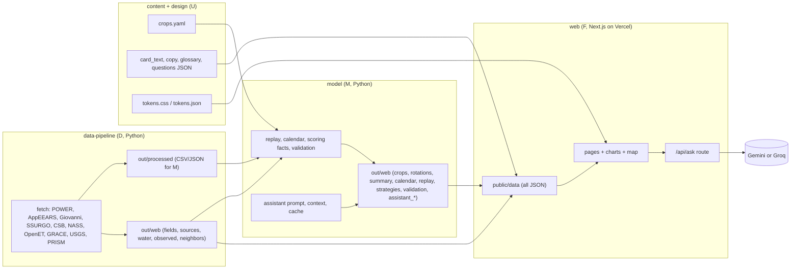

# Team Brackets contract (Glean)

> This was the root README. It is the shared data contract; code and docs cite it as "README §N". The project README is now [../README.md](../README.md).

Create a decision‑support tool that uses NASA Earth observations along with local soil information, crop characteristics, and farmer priorities to help farmers explore rotation strategies that could strengthen soil health and adapt their farms to changing conditions.

> **NASA Space Apps 2026 · Adapting Farms with NASA Data**
>
> A web app that lets a western Kansas farmer compare their current crop rotation against three better-fitting alternatives. Every recommendation is backed by 25 years of replayed weather, real neighbouring fields seen from orbit, and an assistant that only quotes numbers it can trace to a dataset.

| | |
|---|---|
| **Team** | 4 people, one role each |
| **Region** | Finney County, Kansas (FIPS `20055`) |
| **Scope** | 3 demo fields (`f1`, `f2`, `f3`) + ~100–150 neighbouring fields |
| **Stack** | Python (offline) → static JSON → Next.js on Vercel |
| **LLM** | Gemini or Groq, via their OpenAI-compatible endpoints |

**This README is shared by all four roles.** It is the source of truth for file formats, IDs and integration. Each role also gets a handover file with detailed build instructions:

| Role | Handover file | Owns folder(s) |
|---|---|---|
| **D** · Data engineer | [handover/1_DATA.md](../handover/1_DATA.md) | `data-pipeline/` |
| **M** · Modeller + AI | [handover/2_MODEL_AI.md](../handover/2_MODEL_AI.md) | `model/`, `scripts/` |
| **F** · Frontend | [handover/3_FRONTEND.md](../handover/3_FRONTEND.md) | `web/` |
| **U** · Design + content | [handover/4_DESIGN_CONTENT.md](../handover/4_DESIGN_CONTENT.md) | `content/`, `design/` |

## Contents

1. [What we're building](#1-what-were-building)
2. [Demo story](#2-demo-story)
3. [Standout features](#3-standout-features)
4. [Architecture](#4-architecture)
5. [The four roles](#5-the-four-roles)
6. [Repo layout, ownership and integration](#6-repo-layout-ownership-and-integration)
7. [Shared conventions and IDs](#7-shared-conventions-and-ids)
8. [Data contract](#8-data-contract)
9. [AI assistant API](#9-ai-assistant-api)
10. [Datasets at a glance](#10-datasets-at-a-glance)
11. [Must / should / could](#11-must--should--could)
12. [Risks and fallbacks](#12-risks-and-fallbacks)
13. [How this fits the judging criteria](#13-how-this-fits-the-judging-criteria)
14. [Submission checklist](#14-submission-checklist)
15. [Open decisions](#15-open-decisions)

---

## 1. What we're building

The challenge asks for a decision-support tool that compares **at least three rotation strategies, including the existing one**. For each strategy it should say why it was suggested, what evidence supports it, its benefits, where information is missing, and what risks need local review. Every part of this project feeds that comparison.

Western Kansas makes the case on its own. Fields draw on the declining Ogallala aquifer, summers bring heat that hurts corn at pollination, sandy soils still remember the Dust Bowl, and farmers already face a real choice between irrigated corn and dryland wheat–sorghum–fallow.

> **Scope rule:** nothing is fetched live during judging. Python precomputes everything for 3 fields, the app reads static JSON, and the only live call is the AI assistant, which has cached answers as a fallback.

## 2. Demo story

This is what judges see in about 90 seconds. Build toward it; anything that isn't in it is lower priority.

1. A farmer outside Garden City picks their field on the map. The app has already worked out their rotation from USDA crop history (*corn, corn, corn, wheat, corn…*). Their well levels and NASA GRACE both show the aquifer dropping.
2. The **Field Calendar** shows 12 months by rotation year: when the field is bare, when July heat hits corn pollination, and the windy spring months when bare sandy soil blows.
3. They set priorities with sliders (save water, steady income, soil health) and a constraint: "I can pump at most 300 mm (about 12 inches) a season."
4. Four **strategy cards** appear: current rotation plus the top 3. Each has five parts: why, evidence, benefits, information gaps, risks to check locally.
5. **Rotation Replay**: each rotation is run on the field's real weather from 2000 to 2025. The chart shows the 2011–2012 drought and 2022. One alternative needs far less water and has a better worst year.
6. **Farms Like Yours**: nearby fields on the same soil already run wheat–sorghum–fallow. OpenET shows their actual water use, and MODIS greenness shows how they held up in drought years.
7. They ask the **assistant** "Why not alfalfa?" (optionally in Spanish). It answers in plain language, tags each number with its source, and says what to check with the K-State extension agent.

## 3. Standout features

| Feature | What it does | Main owners |
|---|---|---|
| **Rotation Replay** | Simulates each rotation on the field's actual daily weather 2000–2025 with its real soil (FAO-56 daily water budget). Shows irrigation needed, stress days, yield, revenue and bare-soil exposure per year, plus average and worst year. Checked against OpenET satellite ET. | M (model), F (chart) |
| **Farms Like Yours** | Finds Finney County fields with the same soil and irrigation setup that already run a different rotation (USDA Crop Sequence Boundaries + SSURGO), then compares their OpenET water use and MODIS drought-year greenness. Always shows *n* and says it is observational. | D (data), F (view) |
| **AI Field Assistant** | Plain-language chat, English and Spanish. It is only given the field's computed facts. A **number check** marks every number in a reply as verified (traced to a fact and source tag) or unverified. Six suggested questions have cached answers. | M (prompt, context, cache), F (route, UI) |
| **Field Calendar** | Months × rotation years, coloured by crop or bare soil, with 25-year odds of heat, frost, dry spells, storms and wind overlaid. Shows when fields are bare and when crops are vulnerable. | M (data), F (viz), U (colours) |
| **Dust Bowl lens + trust badges** | Wind-erosion exposure (bare days × strong wind × SSURGO wind erodibility), which matters more than water erosion in SW Kansas. Every key number carries a satellite-vs-ground agreement badge. | M, D, F |

## 4. Architecture



| Layer | Choice |
|---|---|
| Pipeline (D, M) | Python 3.11, pandas, numpy, geopandas, shapely, xarray + netCDF4, rasterio, requests, `pyet`, python-dotenv |
| Common analysis unit | **The field outline.** Point and pixel series are sampled at the field centre (MODIS 250 m fits about 8 pixels inside a 50–60 ha Kansas field). Regional layers (SMAP 9 km, GRACE ~300 km) are assigned to the fields they cover. This is our answer to the "harmonize datasets" consideration. |
| Frontend (F) | Next.js (App Router) + TypeScript, Tailwind, shadcn/ui, react-leaflet, Recharts (or ECharts for the calendar) |
| Scoring | In the browser, from precomputed per-scenario summaries, so sliders respond instantly |
| LLM | OpenAI-compatible Chat Completions; provider chosen by environment variables |
| Hosting | Vercel (free tier), GitHub repo `Team-Brackets` |

## 5. The four roles

**Guiding rule: numbers come from D and M, words come from U, and F joins them on screen.** No one hard-codes another role's output. F never writes farmer-facing sentences except fallbacks, and M never writes display text except assistant facts.

| Role | Builds | Delivers to | First thing to deliver |
|---|---|---|---|
| **D · Data** | All dataset downloads, cleaning and per-field tables; the 3 demo fields; the neighbour pool and Farms Like Yours grouping; data sources list | M (processed tables, fields, neighbors), F (fields, water, observed, neighbors, sources) | Real `fields.json` + `weather_daily.csv` for `f1`, then the same for `f2`, `f3` |
| **M · Model + AI** | Crop and rotation library export, Rotation Replay, Field Calendar data, scoring and card facts, validation stats, assistant prompt/context/cache, sync and contract-check scripts | F (all model JSON) | Schema-correct **mock** JSON for every M file, so F can build immediately |
| **F · Frontend** | The Next.js app, all screens and charts, browser-side scoring, the `/api/ask` route and number check, deployment | Judges (the live URL) | App shell deployed on Vercel, running on mock data |
| **U · Design + content** | Wireframes, design tokens and colours, crop trait research (`crops.yaml`), every farmer-facing sentence in EN + ES, glossary, suggested questions, pitch video/slides and submission text | M (`crops.yaml`), F (tokens, all text JSON), team (pitch) | Wireframes + `tokens.css`, then `card_text.json` with all keys (English first) |

## 6. Repo layout, ownership and integration

### 6.1 Folder ownership

```text
Team-Brackets/
├─ README.md                  # shared contract (this file) — changes agreed by all
├─ handover/                  # one brief per role
├─ data-pipeline/             # D
│  ├─ fetch/ … process/ … neighbors/
│  ├─ requirements.txt  .env.example
│  └─ out/
│     ├─ processed/           # D → M (committed; small)
│     └─ web/                 # D → web/public/data (committed)
├─ model/                     # M
│  ├─ replay/ calendar/ scoring/ validate/ assistant/
│  ├─ mock_inputs/            # synthetic stand-ins for D's processed files
│  ├─ requirements.txt  .env.example
│  └─ out/web/                # M → web/public/data (committed)
├─ scripts/                   # M: sync_data.py, check_contract.py
├─ content/                   # U: crops.yaml, card_text.json, copy.json, glossary.json, assistant_questions.json
├─ design/                    # U: tokens.css, tokens.json, wireframes/
├─ web/                       # F: Next.js app
│  └─ public/data/            # filled by scripts/sync_data.py (mocks until then)
└─ docs/                      # METHODS.md (M) · DATA_SOURCES.md (D) · AI_USE.md (M) · PITCH.md, SUBMISSION.md (U)
```

### 6.2 Rules

1. **Only edit your own folders.** If you need something from another role, ask for it. Don't patch their files.
2. **Talk only through files in the data contract (§8).** The file paths and fields there are the API between roles.
3. **Changing the contract** (adding, renaming or removing a field or file) needs the agreement of everyone who reads that file. Update this README in the same commit. Adding an optional field is always safe; renaming or removing one is not.
4. **Every JSON file starts with `_meta`** (§7.3). Mock files set `"mock": true`, and the app shows a "Mock data" banner while any mock file is loaded.
5. **Generated outputs are committed** (`out/` folders, `web/public/data`). Raw downloads are not (`raw/` is gitignored). That way anyone can build the web app without rerunning the pipeline.
6. **No secrets in git.** Use `.env` files (gitignored) and Vercel environment variables.

### 6.3 Who sends what to whom

| From → To | Files |
|---|---|
| D → M | `data-pipeline/out/processed/**` and `data-pipeline/out/web/fields.json`, `field/*/neighbors.json` |
| U → M | `content/crops.yaml` |
| D → F | `data-pipeline/out/web/**` (via sync) |
| M → F | `model/out/web/**` (via sync) |
| U → F | `content/*.json` (via sync), `design/tokens.css`, `design/tokens.json` |
| F → U | `web/COPY_KEYS_ADDED.md`: any copy keys F needed that aren't listed in §8.6 |

### 6.4 How we merge

- One repo, one branch per role: `role/data`, `role/model`, `role/web`, `role/content`. Because each role only touches its own folders, merges into `main` won't conflict.
- Merge to `main` early and often, at least at these three points:
  1. **Mocks merged:** M's mock JSON, U's first tokens and English copy, F's shell. The app runs end to end on fake data.
  2. **Field `f1` real:** D's real `f1` data plus M's real `f1` outputs. One field fully real.
  3. **Everything real:** all 3 fields, assistant cache, final copy.
- If someone works in a separate repo, they copy their folder into this layout before merging.

### 6.5 Final assembly (whoever integrates)

```bash
# 1. merge all role branches into main
git checkout main && git merge role/data role/model role/content role/web

# 2. (only if outputs are stale) rebuild data and model outputs
python data-pipeline/run_all.py           # D's entry point → data-pipeline/out/
python model/run_all.py                   # M's entry point → model/out/web/

# 3. copy every producer's output into the web app
python scripts/sync_data.py               # → web/public/data/ + web/styles/tokens.css

# 4. check the contract: files exist for f1–f3, all scenarios, all IDs and text keys resolve, no mock:true
python scripts/check_contract.py

# 5. build and deploy
cd web && npm ci && npm run build && npx vercel --prod
```

`scripts/sync_data.py` copies:

| Source | Destination |
|---|---|
| `data-pipeline/out/web/**` | `web/public/data/**` |
| `model/out/web/**` | `web/public/data/**` |
| `content/card_text.json`, `copy.json`, `glossary.json`, `assistant_questions.json` | `web/public/data/content/` |
| `design/tokens.css` | `web/styles/tokens.css` |
| `design/tokens.json` | `web/styles/tokens.json` |

(`content/crops.yaml` is not copied. M converts it into `crops.json`.)

## 7. Shared conventions and IDs

### 7.1 Formats

- JSON: UTF-8, `snake_case` keys, no `NaN` or `Infinity` (use `null`).
- Dates `YYYY-MM-DD`; months `YYYY-MM`; month-day `MM-DD`; timestamps ISO 8601 UTC.
- Coordinates `[lon, lat]`, EPSG:4326 everywhere (GeoJSON order).
- **Units in data are metric:** mm, °C, m, m/s, MJ/m²/day, ha. Exceptions, because Kansas farmers use them: area also in acres (`area_ac`), revenue in `usd_ac` (US$ per acre per year), and yields in NASS units (bu/ac, tons/ac, lb/ac).
- Rounding: mm and days to integers, money to whole dollars, indices to 2 decimals, probabilities to 2 decimals (0–1), NDVI to 3 decimals.
- Keep each JSON file under ~2 MB.

### 7.2 IDs (use exactly these strings)

```ts
type FieldId     = "f1" | "f2" | "f3";      // f1 irrigated pivot, f2 dryland, f3 sandy / wind-erodible
type CropId      = "corn" | "sorghum" | "wheat" | "soybean" | "alfalfa" | "triticale" | "rye_cover" | "cotton" | "fallow";
type RotationId  = "R0" | "R1" | "R2" | "R3" | "R4" | "R5" | "R6";   // R0 = the field's current rotation
type CapId       = "dryland" | "cap150" | "cap300" | "cap450";        // seasonal irrigation limit in mm
type ClimateId   = "actual" | "hotdry";                                // hotdry = +1.5 °C and −15 % rain
type ScenarioKey = `${CapId}|${ClimateId}`;                            // 8 scenarios; default "cap300|actual"
type CriterionId = "water_use" | "income_mean" | "income_worst" | "soil_health"
                 | "water_erosion" | "wind_erosion" | "pest_break" | "heat_frost_risk";
type RotationClass = "continuous_corn" | "corn_wheat_sorghum" | "corn_soy" | "wsf"
                   | "wheat_fallow" | "alfalfa" | "mixed";             // wsf = wheat–sorghum–fallow
type SourceTag   = "POWER" | "IMERG" | "SMAP" | "MODIS" | "HLS" | "ECOSTRESS" | "GRACE" | "SRTM"
                 | "SSURGO" | "CSB" | "NASS" | "OpenET" | "PRISM" | "USGS" | "CoCoRaHS"
                 | "GAEZ" | "AMS" | "FAO56" | "MODEL";
type EquipmentId = "hay" | "cotton";
type Level       = "good" | "fair" | "limited";
type Lang        = "en" | "es";
type Localized   = { en: string; es: string };   // es may be "" → show en
```

**Rotation library** (structure in `rotations.json`, names in `card_text.json`):

| ID | Sequence (one step per crop season) | Notes |
|---|---|---|
| R0 | The field's detected rotation | Per field, from crop history |
| R1 | corn → wheat → sorghum | Limited irrigation |
| R2 | wheat → sorghum → fallow | Dryland classic |
| R3 | wheat → sorghum → triticale (forage) | "Flex fallow": forage instead of fallow |
| R4 | alfalfa ×4 → corn → wheat | Forage, deep roots, high water use |
| R5 | corn → soybean → wheat + rye_cover | Soil health, nitrogen |
| R6 | cotton → wheat → sorghum | COULD tier: warming-climate option |

**Neighbour class → rotation match:** `corn_wheat_sorghum`→R1, `wsf`→R2, `alfalfa`→R4, `corn_soy`→R5, everything else → `null`.

### 7.3 `_meta` block (first key of every JSON file)

```json
"_meta": { "schema": "replay@1", "mock": false, "generated_at": "2026-11-15T03:12:00Z", "generator": "model/replay/run.py" }
```

`schema` is `<file name without .json>@<version>`. Bump the version only on a breaking change.

### 7.4 Placeholder formatting (used by U's templates, rendered by F)

U's sentences contain `{var}` placeholders. M (or D) provides the values in `vars`, and F formats them **by the variable name's suffix**:

| Var name pattern | Rendered as (en) | Example |
|---|---|---|
| ends with `_mm` | `310 mm (12.2 in)` | `{saved_mm}` |
| ends with `_usd_ac` | `$412/ac` | `{revenue_usd_ac}` |
| ends with `_pct` | `12%` | `{bias_pct}` |
| ends with `_days` or `days` | integer | `{bare_windy_days}` |
| ends with `_cm_per_yr` | `−1.2 cm/yr` | `{cm_per_yr}` |
| ends with `_m_per_yr` | `−0.4 m/yr (−1.3 ft/yr)` | `{m_per_yr}` |
| ends with `_crop` | crop name in current language | `{forage_crop}` |
| `year`, `years_from`, `years_to` | raw integer | `{year}` |
| `n`, ends with `_years` | integer | `{n}` |
| `r` | 2 decimals | `{r}` |
| anything else | number with up to 1 decimal, or string as-is | |

Spanish uses the same formats (e.g., `310 mm (12,2 pulg.)`, decimal comma optional).

## 8. Data contract

### 8.1 All files

Paths under `web/public/data/` (served at `/data/...`). `{fid}` ∈ `f1|f2|f3`.

| File | Producer | Consumers | Schema |
|---|---|---|---|
| `fields.json` | D | M, F | §8.3 |
| `sources.json` | D | F (citations), M (route context) | §8.3 |
| `field/{fid}/water.json` | D | F, M (summary) | §8.3 |
| `field/{fid}/observed.json` | D | F, M (validation) | §8.3 |
| `field/{fid}/neighbors.json` | D | F, M (evidence) | §8.3 |
| `crops.json` | M (from U's `crops.yaml`) | F | §8.4 |
| `rotations.json` | M | F | §8.4 |
| `field/{fid}/summary.json` | M | F | §8.4 |
| `field/{fid}/calendar.json` | M | F | §8.4 |
| `field/{fid}/replay.json` | M | F | §8.4 |
| `field/{fid}/strategies.json` | M | F | §8.4 |
| `field/{fid}/validation.json` | M | F | §8.4 |
| `field/{fid}/assistant_context.json` | M | F (`/api/ask`) | §8.4 |
| `field/{fid}/assistant_cache.json` | M | F (`/api/ask`) | §8.4 / §9 |
| `assistant/prompt.json` | M | F (`/api/ask`) | §8.4 |
| `content/card_text.json` | U | F | §8.5 |
| `content/copy.json` | U | F | §8.5 |
| `content/glossary.json` | U | F, M (context) | §8.5 |
| `content/assistant_questions.json` | U | F, M (cache) | §8.5 |
| `data-pipeline/out/processed/**` *(not served)* | D | M | §8.2 |
| `content/crops.yaml` *(not served)* | U | M | §8.5 |
| `design/tokens.css`, `design/tokens.json` | U | F | §8.5 |

### 8.2 D → M processed tables (`data-pipeline/out/processed/`)

CSV, comma-separated, header row, `date` first column, empty cell = missing.

| File | Columns | Coverage |
|---|---|---|
| `{fid}/weather_daily.csv` | `date, tmax_c, tmin_c, tmean_c, rh_pct, ws2m_ms, ws10m_ms, ws10m_max_ms, rs_mj_m2, precip_mm` | NASA POWER, 1981-01-01 → 2025-12-31 (solar may start 1984) |
| `{fid}/precip_imerg_daily.csv` | `date, precip_mm` | IMERG Final daily, 2000-06-01 → latest |
| `{fid}/prism_daily.csv` | `date, tmin_c, tmax_c, precip_mm` | PRISM 4 km, 1991-01-01 → 2025-12-31 |
| `{fid}/ndvi_modis.csv` | `date, ndvi, qa_ok` | MOD13Q1 16-day, 2000 → 2025; `qa_ok` is 0/1 |
| `{fid}/smap_l4_daily.csv` | `date, sm_rootzone_m3m3, sm_surface_m3m3` | SPL4SMGP daily mean, 2015-04 → 2025 |
| `{fid}/openet_monthly.csv` | `month, et_mm` | OpenET ensemble, 2016 → latest |
| `{fid}/ecostress.csv` | `datetime, et_mm_day, esi` | ECOSTRESS passes, 2018 → 2025 (sparse) |
| `{fid}/grace_monthly.csv` | `month, tws_anom_cm` | GRACE/GRACE-FO mascon cell, 2002 → latest (gap 2017-07 → 2018-05) |
| `nass.json` | see below | Finney County / SW district / Kansas |

```ts
interface NassFile {
  _meta: Meta;
  county: "FINNEY"; state: "KS";
  yields: { crop: CropId; practice: "irrigated" | "non_irrigated" | "all"; year: number;
            value: number; unit: "bu/ac" | "tons/ac" | "lb/ac"; level: "county" | "district" | "state" }[];
  prices: { crop: CropId; year: number; value: number; unit: "usd/bu" | "usd/ton" | "usd/lb"; level: "state" | "us" }[];
  acres:  { crop: CropId; practice: "irrigated" | "non_irrigated" | "all"; year: number;
            planted_ac: number; level: "county" | "district" }[];
}
```

M also reads `data-pipeline/out/web/fields.json` (soil, terrain, crop history) and `field/{fid}/neighbors.json`.

### 8.3 D → web files

```ts
interface Meta { schema: string; mock: boolean; generated_at: string; generator: string }

// fields.json
interface FieldsFile { _meta: Meta; fields: Field[] }          // exactly f1, f2, f3
interface Field {
  id: FieldId;
  name: Localized;                                              // e.g. "North pivot (irrigated)"
  kind: "irrigated_pivot" | "dryland" | "sandy_wind";
  county_fips: "20055";
  centroid: [number, number];                                   // [lon, lat]
  geometry: GeoJSON.Polygon;                                    // EPSG:4326, simplified to ≤ 200 vertices
  area_ha: number; area_ac: number;
  irrigated: boolean;
  csb_id: string | null;
  crop_history: { year: number; crop: CropId | "other"; cdl_code: number; cdl_name: string }[];  // oldest → newest
  detected: { rotation_class: RotationClass; sequence: CropId[]; confidence: Level; years: [number, number] };
  soil: Soil;
  terrain: { elev_m: number; slope_pct: number; low_spot: boolean };   // low_spot = cold-air pooling candidate
}
interface Soil {
  mukey: string; map_unit_name: string; component: string; comppct: number;
  texture: string;                       // surface texture, e.g. "loamy fine sand"
  awc_mm_per_m: number;                  // available water capacity, weighted 0–100 cm
  aws_0_100_mm: number;                  // available water storage 0–100 cm
  om_pct: number;                        // surface organic matter
  k_factor: number | null;               // water erodibility (kwfact)
  hydgrp: "A" | "B" | "C" | "D" | "A/D" | "B/D" | "C/D";
  slope_pct: number;
  weg: string | null;                    // wind erodibility group, e.g. "1", "4L"
  wei_t_ac_yr: number | null;            // wind erodibility index
  drainage_class: string;
  restrictive_depth_cm: number | null;
}

// sources.json
interface SourcesFile { _meta: Meta; sources: {
  tag: SourceTag; name: string; provider: string; url: string;
  what: string; resolution: string; period: string; used_for: string;
}[] }

// field/{fid}/water.json
interface WaterFile {
  _meta: Meta; field_id: FieldId;
  grace: { cell_center: [number, number]; series: { month: string; tws_anom_cm: number }[];
           trend_cm_per_yr: number; period: [string, string] };
  wells: { site_id: string; name: string; distance_km: number;
           series: { date: string; depth_to_water_m: number }[]; trend_m_per_yr: number | null }[];
  smap_rootzone_anom: { month: string; anom_pct: number }[];     // vs 2015–2025 monthly mean
}

// field/{fid}/observed.json
interface ObservedFile {
  _meta: Meta; field_id: FieldId;
  ndvi_modis: { date: string; ndvi: number }[];                  // QA-filtered 16-day series
  ndvi_climatology: { doy: number; mean: number; p10: number; p90: number }[];   // 23 composites
  drought_years: { year: number; ndvi_summer_anom_pct: number }[];               // Jun–Aug vs 2016–2019 mean
  openet_monthly: { month: string; et_mm: number }[];
  ecostress: { datetime: string; et_mm_day: number | null; esi: number | null }[];
  precip_check: { month: string; power_mm: number; imerg_mm: number | null; cocorahs_mm: number | null }[];
}

// field/{fid}/neighbors.json
interface NeighborsFile {
  _meta: Meta; field_id: FieldId;
  pool_size: number; matched: number;
  method: { features: string[]; k: number; note: string };
  groups: {
    rotation_class: RotationClass;
    matches_rotation: RotationId | null;     // see §7.2 mapping
    is_current: boolean;                     // same class as the demo field
    n: number;
    et_mm_yr_median: number | null;          // OpenET, annual
    ndvi_drop_2012_pct: number | null;
    ndvi_drop_2022_pct: number | null;
    esi_summer_mean: number | null;
  }[];
  fields: { id: string; centroid: [number, number]; geometry: GeoJSON.Polygon;
            rotation_class: RotationClass; irrigated: boolean; similarity: number }[];   // similarity 0–1
}
```

### 8.4 M → web files

```ts
// crops.json — converted from content/crops.yaml (same fields, see §8.5)
interface CropsFile { _meta: Meta; crops: Record<CropId, CropTraits> }

// rotations.json — structure only; names live in card_text.json
interface RotationsFile { _meta: Meta; rotations: Rotation[] }   // R1–R6 (R0 is per field, in summary.json)
interface Rotation {
  id: RotationId;
  steps: { crop: CropId; cover_after: CropId | null }[];          // one step per crop season, cycled
  irrigated: boolean;
  min_cap: CapId;                                                 // lowest water cap where it's feasible
  requires_equipment: EquipmentId[];
  needs_forage_market: boolean;
  tier: "must" | "could";
}

// field/{fid}/summary.json
interface SummaryFile {
  _meta: Meta; field_id: FieldId;
  current_rotation: { steps: { crop: CropId; cover_after: CropId | null }[];
                      rotation_class: RotationClass; years: [number, number] };
  climate: {
    normal: ClimateStats; recent: ClimateStats;
    normal_period: "1991-2020"; recent_period: "2016-2025"; sources: SourceTag[];
  };
  water: { grace_trend_cm_per_yr: number; wells_trend_m_per_yr: number | null;
           outlook: "declining" | "stable" | "rising" };
  headline_facts: { text_id: string; vars: Record<string, number | string>; sources: SourceTag[] }[];  // 3 items
}
interface ClimateStats {
  frost_free_days: number; last_spring_frost: string; first_fall_frost: string;   // MM-DD
  gdd_base10_c: number; precip_mm_yr: number; days_tmax_ge_35: number; et0_mm_yr: number;
}

// field/{fid}/calendar.json
interface CalendarFile {
  _meta: Meta; field_id: FieldId;
  climate_risk: { month: number;                 // 1–12
                  p_heat: number; p_frost: number; p_dry_spell: number;   // 0–1, share of years
                  storm_days: number; windy_days: number }[];             // mean per month
  rotations: { rotation_id: RotationId;
               years: { year_index: number;      // 1…cycle length
                        months: CalendarCell[] }[] }[];                   // 12 cells, Jan → Dec
}
interface CalendarCell {
  state: CropId | "bare";
  stage: "ini" | "dev" | "mid" | "late" | null;
  flags: ("heat" | "frost" | "dry" | "bare_storm" | "bare_wind")[];
}

// field/{fid}/replay.json
interface ReplayFile {
  _meta: Meta; field_id: FieldId;
  years: [2000, 2025];
  drought_years: number[];                         // detected from data, e.g. [2002, 2011, 2012, 2022]
  scenarios: Record<ScenarioKey, Partial<Record<RotationId, ReplayRun>>>;   // all 8 scenarios, R0–R5 (+R6)
}
interface ReplayRun { feasible: boolean; summary: ReplaySummary; by_year: ReplayYear[] }
interface ReplaySummary {
  irrigation_mm_mean: number; eta_mm_mean: number; stress_days_mean: number; rel_yield_mean: number;
  revenue_usd_ac_mean: number; revenue_usd_ac_worst5: number;          // mean of the 5 worst years
  bare_days_mean: number; bare_storm_days_mean: number; bare_windy_days_mean: number;
  water_erosion_idx: number; wind_erosion_idx: number;
  heat_days_mean: number; frost_events_total: number;
}
interface ReplayYear {
  year: number;
  crop_mix: Partial<Record<CropId, number>>;      // share of the rotation's acres in each crop that year (phase-averaged)
  irrigation_mm: number; eta_mm: number; etc_mm: number; stress_days: number; rel_yield: number;
  revenue_usd_ac: number; bare_days: number; water_erosion_idx: number; wind_erosion_idx: number;
  heat_days: number; frost_events: number;
}

// field/{fid}/strategies.json
interface StrategiesFile { _meta: Meta; field_id: FieldId; scenarios: Record<ScenarioKey, StrategyEntry[]> }
interface StrategyEntry {
  rotation_id: RotationId;
  feasible: boolean;
  infeasible_reason_id: string | null;            // key in card_text.infeasible
  criteria: Record<CriterionId, {
    raw: number; unit: string;
    norm: number;                                  // 0–100, higher = better for the farmer (already inverted where needed)
    vars: Record<string, number | string>;         // fills card_text.why[criterion]
  }>;
  requires_equipment: EquipmentId[];
  needs_forage_market: boolean;
  crops_without_local_market: CropId[];            // NASS shows no county acres
  benefits: TextRef[];                             // keys in card_text.benefits
  evidence: (TextRef & { sources: SourceTag[] })[];// keys in card_text.evidence
  gap_ids: string[];                               // keys in card_text.gaps
  risk_ids: string[];                              // keys in card_text.risks
  confidence: Level;
}
interface TextRef { text_id: string; vars: Record<string, number | string> }

// field/{fid}/validation.json
interface ValidationFile { _meta: Meta; field_id: FieldId; items: {
  id: "et_vs_openet" | "sm_vs_smap" | "precip_power_vs_imerg" | "precip_vs_cocorahs";
  metric: "bias_pct" | "r" | "r2"; value: number; n: number; level: Level;
  vars: Record<string, number | string>;           // fills card_text.validation[id]
  sources: SourceTag[];
}[] }

// field/{fid}/assistant_context.json
interface AssistantContext {
  _meta: Meta; field_id: FieldId;
  field_name: string;
  facts: Fact[];                                   // ~80–150 facts, ≤ ~6k tokens in total
}
interface Fact {
  id: string;                                      // e.g. "replay.R2.cap300|actual.irrigation_mm_mean"
  text: string;                                    // English sentence containing the number
  value: number; unit: string | null;              // "mm", "usd_ac", "pct", "days", "cm_per_yr", ...
  source: SourceTag;
  scenario?: ScenarioKey;                          // omit = applies to all scenarios
  rotation_id?: RotationId;
}

// field/{fid}/assistant_cache.json
interface AssistantCache {
  _meta: Meta; field_id: FieldId; scenario: "cap300|actual";
  answers: Record<string, Record<Lang, AskResponse>>;   // question id (q1–q6) → lang → response (§9)
}

// assistant/prompt.json
interface PromptFile {
  _meta: Meta; version: string;
  system: string;     // template with {field_name} {lang_name} {scenario_label} {top_rotations} {facts_block}
  temperature: number; max_tokens: number;
}
```

### 8.5 U files

**`content/crops.yaml`** (read by M; one entry per `CropId`). This is the `CropTraits` type:

```yaml
corn:
  name: { en: "Corn", es: "Maíz" }
  family: poaceae                    # botanical family, for diversity scoring
  host_group: corn                   # pest/disease host group, for pest-break logic
  season: summer                     # summer | winter | perennial | cover | none
  plant_window: { start: "04-20", end: "05-15" }      # MM-DD, Finney County
  harvest_window: { start: "09-20", end: "10-31" }
  stage_days: { ini: 0, dev: 0, mid: 0, late: 0 }     # FAO-56 stage lengths for SW Kansas
  kc: { ini: 0.30, mid: 1.20, end: 0.35 }             # FAO-56 Table 12
  root_max_m: 1.5                                     # FAO-56 Table 22
  p: 0.55                                             # depletion fraction before stress
  ky: 1.25                                            # FAO-33 yield response factor
  heat: { stage: mid, tmax_c: 35 }                    # sensitive stage and damaging Tmax
  frost_kill_c: -2
  requires_irrigation: false
  n_fixing: false
  residue: high                                       # low | medium | high
  root_type: fibrous                                  # fibrous | tap | deep_tap
  forage: false
  yield: { nass_commodity: "CORN", unit: "bu/ac", irrigated_default: null, dryland_default: null }
  price: { unit: "usd/bu", default: null }
  equipment: []                                       # e.g. [hay]
  sources: ["FAO-56 Table 12", "FAO-56 Table 22", "FAO-33", "K-State Research and Extension"]
```

**`content/card_text.json`**

```ts
interface CardText {
  _meta: Meta;
  rotations: Record<RotationId, { name: Localized; tagline: Localized }>;
  criteria_labels: Record<CriterionId, Localized>;
  why: Record<CriterionId, Localized>;              // templates, vars per §8.6
  benefits: Record<string, Localized>;
  evidence: Record<string, Localized>;
  gaps: Record<string, Localized>;
  risks: Record<string, Localized>;
  infeasible: Record<string, Localized>;
  headline: Record<string, Localized>;
  validation: Record<string, Localized>;
}
```

**`content/copy.json`:** `{ _meta, strings: Record<string, Localized> }` with the keys in §8.6.

**`content/glossary.json`:** `{ _meta, terms: { id: string; term: Localized; short: Localized; long: Localized }[] }`.
Required ids: `et, et0, ndvi, soil_moisture_anomaly, root_zone, frost_risk, gdd, water_balance, evaporative_stress, aquifer, rotation, cover_crop, fallow, nitrogen_fixing, wind_erosion, water_erosion, satellite_vs_ground, model_estimate`.

**`content/assistant_questions.json`:** `{ _meta, questions: { id: "q1"…"q6"; text: Localized }[] }`.

**`design/tokens.css`:** plain CSS custom properties on `:root`, plus `[data-theme="dark"]` overrides if dark mode is done. Required names:
`--color-bg, --color-surface, --color-fg, --color-muted, --color-border, --color-accent, --color-good, --color-fair, --color-limited, --crop-corn, --crop-sorghum, --crop-wheat, --crop-soybean, --crop-alfalfa, --crop-triticale, --crop-rye_cover, --crop-cotton, --crop-fallow, --crop-bare, --rot-R0 … --rot-R6, --risk-heat, --risk-frost, --risk-dry, --risk-storm, --risk-wind, --font-display, --font-body, --font-mono, --radius`.

**`design/tokens.json`:** the same values as hex/strings, `{ "color": {...}, "crop": {...}, "rot": {...}, "risk": {...}, "font": {...} }`, for chart and map libraries that can't read CSS variables.

### 8.6 Text key catalog

M must only use these keys and vars. U must write a template for every key. F renders them with §7.4 formatting.

**`why.<criterion>`** (vars come from `strategies[].criteria[criterion].vars`)

| Criterion | Vars |
|---|---|
| `water_use` | `irrigation_mm`, `saved_mm` (vs R0; negative = more water) |
| `income_mean` | `revenue_usd_ac`, `diff_usd_ac` (vs R0) |
| `income_worst` | `worst5_usd_ac`, `r0_worst5_usd_ac` |
| `soil_health` | `score`, `living_root_days`, `legume_years` |
| `water_erosion` | `bare_storm_days`, `r0_bare_storm_days` |
| `wind_erosion` | `bare_windy_days`, `r0_bare_windy_days` |
| `pest_break` | `max_run_years`, `r0_max_run_years` |
| `heat_frost_risk` | `heat_days`, `r0_heat_days` |

**`benefits.*`:** `water_saved {saved_mm}` · `bare_days_reduced {days}` · `legume_added {legume_years, cycle_years}` · `income_steadier {worst5_gain_usd_ac}` · `pest_cycle_broken {max_run_years}` · `forage_income {forage_crop}`

**`evidence.*`:** `replay_avg {years_from, years_to, irrigation_mm, revenue_usd_ac}` · `replay_drought {year, irrigation_mm, r0_irrigation_mm}` · `neighbors {n, et_mm, r0_et_mm}` · `validation_et {bias_pct}`

**`gaps.*`** (no vars): `no_pest_data` · `costs_not_modelled` · `prices_constant` · `openet_record_short` · `smap_coarse` · `county_yields` · `neighbors_observational` · `model_simplified` · `crop_params_generic`

**`risks.*`** (no vars): `herbicide_carryover` · `buyer_availability` · `crop_insurance` · `water_rights` · `equipment_access` · `cover_establishment` · `alfalfa_stand_water` · `fallow_wind` · `new_crop_learning` · `seed_availability`

**`infeasible.*`:** `needs_more_water` · `needs_equipment` · `no_local_market`

**`headline.*`:** `grace_trend {cm_per_yr}` · `well_trend {m_per_yr}` · `frost_free_change {days}` · `heat_days_change {days}` · `current_rotation {years_from, years_to}`

**`validation.*`:** `et_vs_openet {bias_pct}` · `sm_vs_smap {r}` · `precip_power_vs_imerg {bias_pct}` · `precip_vs_cocorahs {bias_pct}`

**`copy.json` keys:**

```text
app.name  app.tagline  disclaimer.main  banner.mock  lang.en  lang.es
nav.overview  nav.calendar  nav.plan  nav.replay  nav.neighbors  nav.trust
pick.title  pick.subtitle  pick.open_field
overview.current_rotation  overview.detected_from  overview.soil  overview.climate_shift  overview.water_outlook
overview.outlook.declining  overview.outlook.stable  overview.outlook.rising
priorities.title  priorities.save_water  priorities.income  priorities.steady_income  priorities.soil_health  priorities.erosion
constraints.title  constraints.water_cap  constraints.cap.dryland  constraints.cap.cap150  constraints.cap.cap300  constraints.cap.cap450
constraints.hay_equipment  constraints.cotton_equipment  constraints.forage_buyer
climate.title  climate.actual  climate.hotdry
card.why  card.evidence  card.benefits  card.gaps  card.risks  card.current_badge  card.score  card.confidence  card.hidden_count
calendar.title  calendar.subtitle  calendar.bare  calendar.flag.heat  calendar.flag.frost  calendar.flag.dry  calendar.flag.bare_storm  calendar.flag.bare_wind
replay.title  replay.subtitle  replay.metric.irrigation  replay.metric.revenue  replay.metric.stress  replay.metric.bare  replay.drought_marker
neighbors.title  neighbors.subtitle  neighbors.disclaimer  neighbors.n_fields  neighbors.water_use  neighbors.drought_greenness
trust.title  trust.subtitle  trust.level.good  trust.level.fair  trust.level.limited  trust.sources  trust.glossary
assistant.title  assistant.placeholder  assistant.send  assistant.suggested  assistant.verified  assistant.unverified  assistant.using_cache  assistant.error
```

F may add keys with an inline English fallback (`t("key", "Fallback")`) and must list them in `web/COPY_KEYS_ADDED.md` for U.

### 8.7 Scoring rules (implemented by F, inputs from M)

Slider weights (0–5 each) map to criteria:

| Slider | Criteria (share of the slider weight) |
|---|---|
| Save water | `water_use` 1.0 |
| Income | `income_mean` 1.0 |
| Steady income | `income_worst` 0.7, `heat_frost_risk` 0.3 |
| Soil health | `soil_health` 0.7, `pest_break` 0.3 |
| Erosion control | `wind_erosion` 0.6, `water_erosion` 0.4 |

```text
w_k        = Σ over sliders (slider_value × share_k)
score(r)   = Σ_k w_k × norm_k(r) / Σ_k w_k          (0–100; if all sliders are 0, use equal weights)
excluded   = !feasible  OR  requires_equipment ⊄ owned_equipment  OR  (needs_forage_market AND !forage_buyer)
shown      = R0 always  +  top 3 non-excluded rotations by score  (ties → lower irrigation_mm_mean)
why bullets = the 3 criteria with the highest w_k × norm_k where norm_k ≥ 50, rendered from card_text.why
```

## 9. AI assistant API

Implemented by F in `web/app/api/ask/route.ts`. M provides `prompt.json`, `assistant_context.json` and `assistant_cache.json`, and tests the same prompt offline in Python.

**`POST /api/ask`**

```ts
interface AskRequest {
  field_id: FieldId;
  lang: Lang;
  scenario: ScenarioKey;
  question_id?: string;              // "q1"…"q6" → served from cache, no LLM call
  question?: string;                 // free text, ≤ 500 chars (required if no question_id)
  top_rotations?: RotationId[];      // what the UI currently shows, best first
  history?: { role: "user" | "assistant"; content: string }[];   // last ≤ 6 turns
}

interface AskResponse {
  answer_md: string;                 // markdown with [TAG] source tags
  citations: { tag: SourceTag; name: string; url: string }[];    // tags found in the answer, resolved via sources.json
  numbers: { text: string; value: number; unit: string | null;
             verified: boolean; fact_id: string | null }[];
  cached: boolean;
  provider: "gemini" | "groq" | "cache";
  model: string | null;
  notice?: "using_cache" | "scenario_mismatch";   // scenario_mismatch: cached answer is for cap300|actual
}

// errors
// 400 { error: "bad_request", message }
// 503 { error: "llm_unavailable", message }   → UI falls back to the suggested-question chips
```

**Server flow**

1. Validate the request. If `question_id` is set, return the cached answer (`cached: true`, add `notice: "scenario_mismatch"` when the scenario isn't `cap300|actual`).
2. Load `prompt.json` and the field's `assistant_context.json` (static imports). Keep facts with no `scenario` or `scenario === request.scenario`.
3. Build `facts_block`, one line per fact: `- (fact_id) text [SOURCE]`. Fill the template placeholders. `lang_name` is "English" or "Spanish".
4. Call `POST {LLM_BASE_URL}/chat/completions` with `{ model: LLM_MODEL, messages: [system, ...history, user], temperature, max_tokens }` and `Authorization: Bearer {LLM_API_KEY}`. Timeout 20 s.
5. Run the **number check** (below), extract `[TAG]` citations, return `AskResponse`.
6. On LLM error or timeout: return 503 for free-text questions.

**Environment variables** (server-side only, never `NEXT_PUBLIC_`):

| Var | Gemini | Groq |
|---|---|---|
| `LLM_PROVIDER` | `gemini` | `groq` |
| `LLM_BASE_URL` | `https://generativelanguage.googleapis.com/v1beta/openai` | `https://api.groq.com/openai/v1` |
| `LLM_MODEL` | current Gemini Flash model id from AI Studio | current Llama model id from the Groq console |
| `LLM_API_KEY` | AI Studio key | Groq key |

**Number check** (identical in TypeScript `web/lib/numberCheck.ts` and Python `model/assistant/number_check.py`):

1. Find numbers with the pattern `\$?-?\d{1,3}(,\d{3})*(\.\d+)?|\$?-?\d+(\.\d+)?`, each optionally followed by a unit: `mm | in | inches | % | °C | °F | days? | years? | cm | m | ft | ac | acres | bu | tons? | /ac`. A leading `$` means unit `usd`.
2. Skip: 4-digit integers between 1980 and 2035 (years), list markers at the start of a line (`1.`), and numbers inside `[TAG]` or `(fact_id)`.
3. Convert before comparing: `in → mm ×25.4`, `°F → °C`, `ft → m ×0.3048`.
4. A number is **verified** if some fact has `|x − value| ≤ max(0.05 × |value|, rounding step of x)`, with a compatible unit (or either unit null). Record that fact's `fact_id`.
5. UI: verified numbers get a subtle check and source tooltip; unverified numbers get an "unverified" badge.

## 10. Datasets at a glance

Details, endpoints and fallbacks are in [handover/1_DATA.md](../handover/1_DATA.md).

| Tier | Dataset | Used for |
|---|---|---|
| MUST | NASA POWER daily | Replay weather, ET0, heat/frost/wind days |
| MUST | USDA Crop Sequence Boundaries / CDL | Field outlines, crop history, current rotation, neighbour pool |
| MUST | SSURGO (Soil Data Access) | Water-holding capacity, erodibility, soil-health inputs, matching |
| MUST | USDA NASS QuickStats | Yields, prices, local-market check |
| MUST | MODIS NDVI (AppEEARS) | Season curves, bare windows, drought-year greenness, neighbours |
| MUST | SMAP L4 root-zone (AppEEARS) | Soil-water check, dry-period context |
| SHOULD | OpenET | Replay validation, neighbours' real water use |
| SHOULD | GPM IMERG (Giovanni) | Storm days, rainfall cross-check |
| SHOULD | GRACE/GRACE-FO, USGS wells | Water outlook (aquifer trend) |
| SHOULD | ECOSTRESS, SRTM, PRISM | Stress snapshots, slope and low spots, climate normals vs recent |
| COULD | HLS, CoCoRaHS, GAEZ, AMS, NAIP/Sentinel-2 | Sharper NDVI, rain gauge badge, future fit, local prices, basemap |
| SKIP (explain why) | GEDI, LANDFIRE, NLCD, ERA5, GLDAS, NLDAS, STATSGO2, Ag Data Commons | Not useful at this scale or covered better by the sources above. ERA5/GLDAS are the path to going global. |

## 11. Must / should / could

| MUST | SHOULD | COULD |
|---|---|---|
| 3 fields with real POWER, SSURGO, CSB, NASS data | Farms Like Yours | Spanish toggle everywhere, voice |
| Replay for all 8 scenarios | Assistant with number check + cache | HLS sharper NDVI |
| Field Calendar | OpenET validation badges | CoCoRaHS rainfall badge |
| Priorities, constraints + 4 cards with all five sections | Water outlook (GRACE + wells) | GAEZ future-fit line |
| "Supports, doesn't replace your judgement" notice | Wind and water erosion indices | NAIP basemap |
| Deployed URL | Hotter-drier toggle | R6 cotton, agronomist summary page |

If time runs short, cut from the right column first.

## 12. Risks and fallbacks

| Risk | Fallback | Owner |
|---|---|---|
| AppEEARS queue is slow | ORNL DAAC MODIS subset service for NDVI (no login); drop ECOSTRESS; calendar uses crop windows only | D |
| CSB file is huge or awkward | CropScape CDL value lookups at field centres per year; draw the 3 outlines by hand | D |
| Water-balance numbers look wrong | Check units (MJ vs W/m², mm vs m, AWC cm/cm); fall back to a weekly bucket | M |
| OpenET key or coverage problems | Validate with SMAP + NDVI; neighbours use NDVI only | D, M |
| LLM rate limits / outage | Cached chip answers; switch provider via environment variables | F, M |
| Contract drift between roles | `scripts/check_contract.py` before every merge to `main` | M |
| Overclaiming | U reviews all copy: "may", "estimated", "in similar fields"; every card lists gaps | U |

## 13. How this fits the judging criteria

Space Apps used these criteria in past years. Check the 2026 rules.

| Criterion | What we point to |
|---|---|
| Impact | Aquifer decline + wind-erodible soils are real, current Kansas problems; water saved shown in mm and inches per field |
| Creativity | Rotation Replay, Farms Like Yours, number-checked assistant, wind-erosion lens |
| Validity | FAO-56 method validated against OpenET and SMAP; every card lists gaps and risks; skipped-datasets list with reasons |
| Relevance | Meets the ≥3 strategies + why/evidence/benefits/gaps/risks spec; uses SMAP, GPM, MODIS, Landsat/HLS, POWER, ECOSTRESS, GRACE, SRTM |
| Presentation | Demo story (§2), Field Calendar as the opening visual, plain language, Spanish |

## 14. Submission checklist

- [ ] Check the 2026 rules for the demo format (past years: a 30-second video *or* up to 7 slides)
- [ ] Project summary, live Vercel URL, GitHub repo link
- [ ] NASA data used + partner data (Sentinel-2 if used) + other sources, with links (`docs/DATA_SOURCES.md`)
- [ ] AI disclosure: the in-app LLM, and AI tools used for planning and coding (`docs/AI_USE.md`)
- [ ] No NASA logos or branding in the app
- [ ] Repo public, no API keys committed, `check_contract.py` passes with no mock files

## 15. Open decisions

- **Gemini or Groq?** Recommendation: Gemini Flash (better Spanish, longer context). Groq is faster. The route supports both, so keep the other key as a backup.
- **Project name.** Options: RootCycle, FieldShift, Second Season. U decides.
- **The exact 3 fields.** D picks them from CSB + imagery as the first task: one irrigated pivot, one dryland W–S–F field, one sandy field with high wind erodibility.
- **Video or slides.** Follow the 2026 rules. If both are allowed, a 30-second screen capture of the demo story shows the product best.

---

*Plan date: 14 Nov 2026. Numbers in examples (thresholds, coordinates, crop parameters) are starting points to verify against the real data and sources.*

## 16. Contract amendments (15 Nov 2026)

The integration pass found mismatches between this contract and what each role publishes. Changes C1 to C12 in [CONTRACT_CHANGES.md](../CONTRACT_CHANGES.md) are now part of this contract and override the sections they cite: text-only facts (`value: null`), nullable crop traits, well-trend sign, the tie-break source, dropping alternatives that equal R0, the `hidden_count` set, the 94 added copy keys, the number-check identifier rule, the 429 rate-limit response, when `notice` is sent, groups with no `is_current` row, and sources listed only when their data reached `out/`.
